# Deep Research: Fuentes Abiertas Verificadas, Auditoría de Candidatas y Propuesta de Almacén Ampliado con Cubo de Datos (IJCOPI — ID 38)

**Fecha de verificación:** 31 de octubre de 2026  
**Alcance:** Extensión del almacén de datos y grafo RDF del artículo ID 38 (*ICOKG 2026* → número especial de *IJCOPI*, ISSN 2007-1558, entrega el 9 de noviembre de 2026).  
**Base previa no repetida:** Este documento parte de los hallazgos ya verificados en `reports/Datos abiertos de agua CDMX.md`, `research_notes/Datos abiertos de agua CDMX/` y la implementación de referencia en `Actronix09/fuentes-alternas` (`agua-reportes-sacmex/`).  
**Segunda revisión (misma fecha):** Se agregó el Bloque D con fuentes hídricas de la Zona Metropolitana de Ciudad de México, el Estado de México y el resto del país, y se implementó el ETL en [`warehouse_ampliado/`](../warehouse_ampliado/). El cubo de datos sigue pendiente. Cada cifra de esa implementación se recalcula en [`warehouse_ampliado/verificacion/evidencia_ampliado.txt`](../warehouse_ampliado/verificacion/evidencia_ampliado.txt).

---

## 0. Correcciones a la versión anterior de este informe

Al revisar los archivos completos, varias afirmaciones de la primera versión resultaron falsas. Ya están corregidas abajo. Se listan aquí porque cualquier texto derivado de esa versión debe revisarse, en especial lo referente a fugas.

| La versión anterior decía | Lo que muestra la fuente | Comprobación |
| --- | --- | --- |
| 55,103 reportes en ene–jun 2019, con 39,685 de falta de agua y 9,731 de fuga | **39,685 reportes, todos de falta de agua.** No hay reportes de fuga ni de mala calidad antes de 2021 | Conteo sobre `historico_2018_2021.csv`, con el MD5 oficial del CKAN |
| Las colonias con muchas fugas se pueden contrastar con el consumo de 2019 | **No hay fugas registradas en 2019.** Solo existen de 2021 a 2024 (133,577 de agua potable) | Conteo por año en `fact_reporte_agua` |
| Reportes hasta julio de 2024 | La última fecha es el **1 de febrero de 2024** | Fechas en `fact_reporte_agua` |
| Iztapalapa 2015: $Z = 0.5625$, percentil 95.63 %; pesos 0.1489, 0.1301 y 0.1257 | **Ninguna de esas cifras aparece en el PDF.** El Apéndice E da $Z = 0.920$, ajuste beta 0.995 y percentil 100 % | Búsqueda de texto en las 38 páginas |
| Dotación 2015: Iztapalapa 256, Milpa Alta 152 y Coyoacán 423 L/hab/día | La Tabla 2 da **215.05, 431.6 y 376.62** | Tabla 2, p. 12 |
| InSAR separado por espacios, hasta −40 cm/año, cobertura ZMVM | **Separado por comas, mínimo −31.69 cm/año**, de 18.25 a 20.40°N y de 99.50 a 98.20°O | Archivo completo y `README.rtf` |
| MD5 de `README.rtf`: `49617dd9…` | `13066d148d2cabd182bfd2e58cc578c2` | API de Figshare y descarga |
| 59 municipios conurbados en el Estado de México | La delimitación oficial de 2020 da **45 del Estado de México y 2 de Hidalgo**, 63 con las 16 alcaldías | Fuente `D1` |
| 1,550 colonias en `dim_ubicacion` | **1,553.** Las 1,550 son las que reciben población censal por proximidad | `dim_ubicacion` |
| Ráster con 12 bandas mensuales | 12 archivos GeoTIFF, uno por mes | Listado de los ZIP |
| 550,948 reportes enlazados | 551,008 con la regla implementada | `fact_reporte_agua` |

---

## 1. Criterios de validación (lecciones de la revisión docente)

A partir de la revisión del profesor César Javier Martínez Ruiz al repositorio `prdx919/Agua_en_la_cdmx` y de las reglas de `AGENTS.md`, toda fuente que entre al almacén ampliado debe cumplir cuatro condiciones estrictas:

1. **Verificación primaria de identificadores y cifras:** Cada DOI, ISBN, URL de descarga, tamaño de archivo, suma criptográfica (MD5 / SHA-256) y cifra numérica se comprueba directamente contra la API del registro (`doi.org`, Crossref, Figshare API, Zenodo API, CKAN API) y el archivo descargado antes de citarse.
2. **Ingesta mediante ETL real y reproducible:** Ningún dato entra como constante escrita a mano (`INSERT ... VALUES` arbitrarios en SQL o arreglos fijos en JavaScript) ni como archivo `CSV` suelto que el ETL no procesa. Todo dato proviene de un archivo fuente descargado con suma SHA-256/MD5 verificada y script de carga determinista.
3. **Prohibición de referencias decorativas:** Toda fuente citada en el catálogo o en el texto como fuente de datos del almacén debe aportar registros o parámetros reales a alguna tabla de hechos o dimensión. Si un libro con ISBN o un artículo con DOI solo aporta contexto teórico pero no alimenta una tabla mediante ETL, **no se registra como fuente de datos del almacén** (solo puede citarse en el marco teórico o discusión del artículo).
4. **Integración real con el modelo original:** Los datos nuevos no se añaden como capas aisladas; se enlazan con las dimensiones y hechos originales (`dim_ubicacion`, `dim_tiempo`, `dim_indice_des`, `fact_consumo_agua`, `fact_clima`) mediante llaves espaciales, temporales y estadístico-geográficas verificadas (`cve_col`, `CVEGEO`, `id_ubicacion`, `id_tiempo`), culminando en un **Esquema de Constelación de Hechos** y un **Cubo de Datos OLAP y RDF (`qb:DataSet`)**.

---

## 2. Fuentes abiertas verificadas para alimentar el almacén y el cubo

Las fuentes verificadas se dividen en cuatro bloques complementarios:
- **Bloque A:** Conjuntos de datos científicos abiertos **con DOI verificado y descarga directa** (climáticos de alta resolución, subsidencia diferencial por InSAR e índice multidimensional de vulnerabilidad hídrica por alcaldía).
- **Bloque B:** Conjuntos de datos estadísticos y geográficos oficiales federales (INEGI Censo 2020, Marco Geoestadístico 2020, DENUE y Censos Económicos 2019) con descarga directa verificada (`HTTP 206`, archivo ZIP válido).
- **Bloque C:** Conjuntos de datos oficiales de la CDMX (SACMEX reportes ciudadanos verificados por MD5/SHA-256, IECM polígonos de colonias 2019, EVALÚA CDMX IDS 2020, IPDP tandeo y tarifas del Art. 172 del Código Fiscal CDMX).
- **Bloque D:** Fuentes hídricas de la Zona Metropolitana de Ciudad de México, el Estado de México y el resto del país (INEGI CNGMD, CONAGUA, SHCP, CONAPO y Zenodo), todas cargadas al almacén.

Hashes, tamaños y URL de todo lo cargado están en [`warehouse_ampliado/fuentes.json`](../warehouse_ampliado/fuentes.json).

---

### Bloque A — Fuentes científicas con DOI verificado y enlace directo de descarga

#### A1. `MexHiResClimDB` — Base climática mallada de alta resolución para México (Carrera-Hernández, 2025)
Resuelve de raíz una limitación estructural del almacén original: en la versión de ICOKG, `fact_clima` proviene de un único punto de Open-Meteo (`19.44°N, 99.11°W`, Venustiano Carranza, 181 días), por lo que todas las colonias compartían el mismo clima diario y `fact_clima` no tenía llave hacia `dim_ubicacion`. Con `MexHiResClimDB` (resolución de **20 segundos de arco, ~600 m** en `EPSG:4326`), cada una de las **1,553 colonias** de `dim_ubicacion` obtiene su propia temperatura máxima, mínima, media y precipitación en los 12 meses de 2019.

- **Artículo descriptivo (DOI verificado):** [`10.5194/essd-17-6911-2025`](https://doi.org/10.5194/essd-17-6911-2025) — Carrera-Hernández, J. J. (2025). *MexHiResClimDB: Mexico's High Resolution Climate Database*. Earth System Science Data, 17(12), 6911–6935.
  - **URL directa del PDF (verificada HTTP 206):** `https://essd.copernicus.org/articles/17/6911/2025/essd-17-6911-2025.pdf`
- **Colección en Figshare (DOI verificado):** [`10.6084/m9.figshare.c.7689428.v2`](https://doi.org/10.6084/m9.figshare.c.7689428.v2) (Licencia `CC BY 4.0`).
- **Archivos de 2019 con DOI individual, tamaño y MD5 verificados en la API de Figshare (`api.figshare.com/v2`):**

| Variable y granularidad (2019) | DOI individual verificado | URL de descarga directa (`ndownloader`) | Archivo | Tamaño exacto | MD5 oficial verificado |
| --- | --- | --- | --- | --- | --- |
| **Precipitación mensual 2019** | `10.6084/m9.figshare.28462787.v1` | `https://ndownloader.figshare.com/files/52541417` | `monthlyprecip2019.zip` | 47,353,428 B (45.2 MB) | `35fe2578a39b28c1d96cf481b946f98f` |
| **Temp. máxima mensual 2019** | `10.6084/m9.figshare.28462679.v2` | `https://ndownloader.figshare.com/files/52540979` | `monthlytmax2019.zip` | 101,520,092 B (96.8 MB) | `f1a80ade219b13065e8bca5e963de150` |
| **Temp. mínima mensual 2019** | `10.6084/m9.figshare.28124789.v1` | `https://ndownloader.figshare.com/files/51452765` | `monthlytmin2019.zip` | 102,422,715 B (97.7 MB) | `2d358f9dc9b75cb50b8b18c1b5832709` |
| **Temp. media mensual 2019** | `10.6084/m9.figshare.28462769.v1` | `https://ndownloader.figshare.com/files/52541174` | `monthlytavg2019.zip` | 99,056,025 B (94.5 MB) | `127e69028640906460f42b652d8dabb0` |
| *(Opcional)* **Precip. diaria 2019** | `10.6084/m9.figshare.28462796.v1` | `https://ndownloader.figshare.com/files/52541612` | `dailyprecip2019.zip` | 123,713,596 B (118.0 MB) | `62a0124efebaa06d7098004dcbecc9b1` |
| *(Opcional)* **Tmax diaria 2019** | `10.6084/m9.figshare.28462820.v1` | `https://ndownloader.figshare.com/files/52542164` | `dailytmax2019.zip` | 252,477,260 B (240.8 MB) | `2be3f093cc2475fb8ed178c6252b633c` |
| *(Opcional)* **Tmin diaria 2019** | `10.6084/m9.figshare.28462808.v1` | `https://ndownloader.figshare.com/files/52541978` | `dailytmin2019.zip` | 269,243,217 B (256.8 MB) | `54156f2a571c00f9faec757d764927a5` |
| *(Opcional)* **Tavg diaria 2019** | `10.6084/m9.figshare.28462835.v1` | `https://ndownloader.figshare.com/files/52542764` | `dailytavg2019.zip` | 256,220,762 B (244.4 MB) | `00d15ef0fb3d7c3f02711284e733b5b5` |

- **Formato:** Un GeoTIFF por mes (`EPSG:4326`, resolución 0.005556° = 20 arcsec ≈ 600 m), 12 archivos dentro de cada ZIP. Se usan los cuatro archivos mensuales; los diarios opcionales no se cargaron.
- **Cobertura:** Todo México; el ETL recorta la caja de la CDMX, el Estado de México e Hidalgo y toma los 12 meses de 2019.
- **Llave de unión al almacén:** En cada colonia, promedio de la celda de cada punto de SACMEX → `(id_ubicacion, id_tiempo)`. En cada municipio, promedio de las celdas cuyo centro cae dentro del polígono → `(cve_mun, id_tiempo)`. `id_tiempo` es el último día del mes.
- **Tablas que alimenta:** **`fact_clima_colonia`** (18,636 filas) y **`fact_clima_municipio`** (2,700 filas). `fact_clima` no cambia. En Venustiano Carranza, ene–jun de 2019, sigue a Open-Meteo con $r = 0.971$ y diferencia media de $-0.01$ °C.

---

#### A2. Velocidad de movimiento vertical del terreno (subsidencia InSAR) en la Ciudad de México (Khorrami et al., 2023)
Proporciona mediciones satelitales reales de hundimiento (Vertical Land Motion, VLM) derivadas de 599 imágenes de radar Sentinel-1 (noviembre de 2014 a noviembre de 2020, periodo que **cubre íntegramente el año 2019**). Permite cruzar la subsidencia diferencial del acuífero con la densidad de reportes de fugas en la red secundaria y el consumo facturado por colonia, sin inventar tasas fijas por alcaldía.

- **Dataset con DOI verificado (Virginia Tech Data Repository / Figshare):** [`10.7294/21935947`](https://doi.org/10.7294/21935947) (versión v2: `10.7294/21935947.v2`, Licencia `CC0 1.0`).
- **Artículo científico asociado (DOI verificado):** [`10.1029/2022GL101962`](https://doi.org/10.1029/2022GL101962) — Khorrami, M., Shirzaei, M., Ghobadi-Far, K., Werth, S., Carlson, G., & Zhai, G. (2023). *Groundwater Volume Loss in Mexico City Constrained by InSAR and GRACE Observations and Mechanical Models*. Geophysical Research Letters, 50(5), e2022GL101962.
- **Enlaces directos de descarga verificados (`HTTP 200`, `api.figshare.com/v2/articles/21935947`):**
  - **Datos (`Fig2_LonLat_dz_std.txt`):** `https://ndownloader.figshare.com/files/38910528` — **18,094,737 bytes (17.26 MB)**, MD5: `fc2030d76d4cd3fe34dc0aefc5719746`.
  - **Diccionario (`README.rtf`):** `https://ndownloader.figshare.com/files/39532615` — **2,466 bytes**, MD5: `13066d148d2cabd182bfd2e58cc578c2` (`supplied_md5` y `computed_md5` de la API de Figshare, y calculado sobre la descarga).
- **Formato y estructura verificada (archivo completo descargado):** Texto **separado por comas**, sin encabezado, con 4 columnas descritas en `README.rtf`:
  1. Longitud en grados.
  2. Latitud en grados.
  3. Velocidad vertical del terreno en $\text{cm/año}$; los valores negativos indican hundimiento. El mínimo del archivo es **$-31.69\text{ cm/año}$**.
  4. Desviación estándar de esa velocidad en $\text{cm/año}$.
- **Cobertura:** 252,179 píxeles entre 18.25–20.40°N y 99.50–98.20°O, con unos 350 m de separación. Es más amplia que la Cuenca de México, pero **no llega al poniente de 99.5°O**, así que el Valle de Toluca queda casi fuera (Sentinel-1, noviembre de 2014 a noviembre de 2020).
- **Llave de unión al almacén:** Cada píxel se asigna a su municipio por punto en polígono y, en la CDMX, al punto de consumo de SACMEX más cercano dentro de la misma alcaldía, a menos de 500 m. Sigue siendo proximidad y no polígono de colonia, porque los polígonos del IECM (`C2`) están bloqueados.
- **Tablas que alimenta:** **`fact_subsidencia_municipio`** (128 municipios) y **`fact_subsidencia_colonia`** (1,400 colonias), con `n_pixeles`, media, mínimo, percentiles 10 y 90 y desviación media. El rango entre percentiles aproxima el hundimiento diferencial; que ese rango dañe la red es una hipótesis por probar, no un resultado.

---

#### A3. Indicadores históricos de disponibilidad, dotación, tratamiento y vulnerabilidad hídrica por alcaldía (Huerta-Vergara et al., 2022)
En el repositorio rechazado `prdx919/Agua_en_la_cdmx`, el alumno citó este artículo pero inventó valores para 2019. Al descargar y auditar las 38 páginas del PDF original (`5,132,456 bytes`), verificamos que el artículo **sí contiene tablas numéricas completas y explícitas para las 16 alcaldías de la CDMX en tres cortes quinquenales (2005, 2010 y 2015)** (48 filas alcaldía-año), que alimentan la tabla de contexto histórico `fact_vulnerabilidad_alcaldia`.

- **DOI verificado:** [`10.18268/BSGM2022v74n1a071021`](https://doi.org/10.18268/BSGM2022v74n1a071021) — Huerta-Vergara, A. R., Escolero, O., & Kralisch, S. (2022). *Assessment of vulnerability to water shortage in municipalities of Mexico City*. Boletín de la Sociedad Geológica Mexicana, 74(1), A071021. (Licencia `CC BY-NC-SA 4.0`).
- **URL directa de descarga verificada (`HTTP 206`, servidor primario UNAM):**
  - `https://boletinsgm.igeolcu.unam.mx/bsgm/vols/epoca04/7401/A071021_Huerta.pdf` (**5,132,456 bytes**, SHA-256 verificable en ETL con extracción automática mediante `pypdf`).
- **Contenido tabular exacto verificado dentro del PDF:**
  - **Tabla 1 (pp. 7–8):** Valores crudos para las 16 alcaldías en **2005, 2010 y 2015** de 9 variables: área urbana ($\text{km}^2$), población (`Populat.`), unidades económicas (`Econo. unit.`), reportes de fugas (`W. leak. rep.`), reportes de falta de agua (`W. shortages rep.`), reportes de mala calidad (`Poor w. quality rep.`), caudal de agua residual tratada (`Sewag. treat. l/s`), caudal de agua disponible (`W. availab. l/s`) y PIB municipal (`GDP mp`).
  - **Tabla 2 (p. 12):** Dotación hídrica en litros por habitante por día (`Water endowment LPCD`) y categoría de vulnerabilidad para las 16 alcaldías en 2005, 2010 y 2015. En 2015: Iztapalapa = $215.05$, Milpa Alta = $431.6$ y Coyoacán = $376.62\text{ L/hab/día}$.
  - **Apéndices B, C, D y E (pp. 31–37):** Valores normalizados $[0,1]$, pesos de Iyengar-Sudarshan, cálculo e índice compuesto $Z$ para los 48 registros alcaldía-año. Iztapalapa 2015: $Z = 0.920$, ajuste beta $0.995$, percentil $100\%$, grado *Very High*.
- **Llave de unión al almacén:** Nombre normalizado de alcaldía → clave INEGI `cve_mun` (`09002` a `09017`) → `dim_municipio` y, por ella, `dim_ubicacion`.
- **Tabla que alimenta:** **`fact_vulnerabilidad_alcaldia`** (48 filas: 16 alcaldías × 2005, 2010 y 2015), leída del PDF por el ETL. La lectura se valida recalculando la normalización del Apéndice B desde la Tabla 1: la diferencia máxima es 0.005, que es el redondeo publicado.
- **Licencia:** `CC BY-NC-SA 4.0`, de modo que estos valores no admiten uso comercial y sus derivados llevan la misma licencia.

---

### Bloque B — Fuentes estadísticas y geográficas federales (INEGI) con descarga directa verificada

Todas las URL siguientes fueron probadas desde esta PC mediante peticiones `GET` con rango de bytes, confirmando código **`HTTP 206 Partial Content`**, encabezado `application/x-zip-compressed` y firma binaria ZIP (`PK\x03\x04`).

| ID | Fuente oficial (INEGI) | URL directa de descarga verificada (`HTTP 206`) | Tamaño exacto | Cobertura y granularidad | Llave de unión al almacén | Tabla que alimenta |
| --- | --- | --- | --- | --- | --- | --- |
| **B1** | **Censo de Población y Vivienda 2020 — Microdatos por AGEB y manzana urbana CDMX (`09`)** | `https://www.inegi.org.mx/contenidos/programas/ccpv/2020/datosabiertos/ageb_manzana/ageb_mza_urbana_09_cpv2020_csv.zip` | **12,990,807 B** (12.39 MB) | 66,000+ manzanas urbanas de las 16 alcaldías de la CDMX (Censo 2020, levantado a meses de los datos de 2019). Variables: `POBTOT`, `VIVTOT`, `TVIVPARHAB`, `VPH_AEASP` (agua entubada), `VPH_TINACO`, `VPH_CISTER`, `GRAPROES`. | `CVEGEO` de 16 dígitos (`09`+`MUN`+`LOC`+`AGEB`+`MZA`) cruzado espacialmente con los puntos de manzana SACMEX y polígonos de colonia (`cve_col`). | Enriquecimiento de **`dim_ubicacion`** (población y viviendas por colonia para calcular $\text{L/hab/día}$ y $\text{m}^3\text{/viv/bim}$) y dimensión puente **`dim_manzana_censal`**. |
| **B2** | **Censo 2020 — Principales resultados por localidad (ITER) CDMX (`09`)** | `https://www.inegi.org.mx/contenidos/programas/ccpv/2020/datosabiertos/iter/iter_09_cpv2020_csv.zip` | **174,925 B** (170.8 KB) | Totales oficiales por alcaldía (`09002`–`09017`) y localidad de la CDMX (población total = 9,209,944 hab.). | Clave geoestadística municipal `09` + `MUN` (`cve_mun`). | No se carga: la sustituye `B10`, que trae los mismos totales para todo el país. |
| **B3** | **Marco Geoestadístico Censo 2020 — CDMX (`09`)** (ISBN colección INEGI) | `https://www.inegi.org.mx/contenidos/productos/prod_serv/contenidos/espanol/bvinegi/productos/geografia/marcogeo/889463807469/09_ciudaddemexico.zip` | **83,207,305 B** (79.35 MB) | Shapefiles (`09mun`, `09a`, `09m`) con polígonos oficiales de alcaldías, AGEB y manzanas de la CDMX. | `CVEGEO` (16 caracteres para manzana, 13 para AGEB, 5 para alcaldía) y cruce espacial punto-en-polígono con coordenadas `(latitud, longitud)` de SACMEX. | Puente espacial en el ETL para asignar cada manzana de Censo 2020 (`B1`) e IDS 2020 (`C3`) a su `id_ubicacion` (`cve_col`) del almacén. |
| **B4** | **Censos Económicos 2019 — Datos Abiertos CDMX (`09`)** | `https://www.inegi.org.mx/contenidos/programas/ce/2019/Datosabiertos/ce2019_cdmx_csv.zip` | **8,460,887 B** (8.07 MB) | Actividad económica de **2018–2019** en la CDMX por sector SCIAN y alcaldía (unidades económicas, personal ocupado, producción bruta). | `cve_mun` (`09002`–`09017`). | **`dim_municipio`** (unidades económicas, personal ocupado y producción bruta, para contextualizar `consumo_no_dom`). |
| **B5** | **DENUE — Directorio Estadístico Nacional de Unidades Económicas CDMX (`09`)** | `https://www.inegi.org.mx/contenidos/masiva/denue/denue_09_csv.zip` | **45,439,249 B** (43.33 MB) | Unidades económicas georreferenciadas (latitud, longitud, clave SCIAN, estrato de personal, AGEB/manzana) en la CDMX. | Municipio del propio archivo y, en la CDMX, punto de consumo de SACMEX más cercano en la alcaldía, a menos de 750 m → `id_ubicacion`. | Conteo de unidades económicas totales e intensivas en agua (lavanderías, hoteles, restaurantes, industria alimentaria y de bebidas) en **`dim_municipio`** y **`dim_ubicacion`**. Es la edición vigente al descargar, de mayo de 2026, no 2019. |
| **B6** | **Censo 2020 — AGEB y manzana urbana Estado de México (`15`)** | `https://www.inegi.org.mx/contenidos/programas/ccpv/2020/datosabiertos/ageb_manzana/ageb_mza_urbana_15_cpv2020_csv.zip` | **25,353,813 B** (24.18 MB) | Manzanas urbanas de los 125 municipios del Estado de México, incluidos los 45 de la ZM de Ciudad de México según la delimitación oficial de 2020 (fuente `D1`). | `CVEGEO` (`15`+`MUN`+`LOC`+`AGEB`+`MZA`). | Extensión metropolitana hacia el Estado de México / ZMVM. |
| **B7** | **Censo 2020 — ITER Estado de México (`15`)** | `https://www.inegi.org.mx/contenidos/programas/ccpv/2020/datosabiertos/iter/iter_15_cpv2020_csv.zip` | **1,799,151 B** (1.72 MB) | Totales por municipio y localidad del Estado de México (`15001`–`15125`: población, viviendas, agua entubada, cisterna, tinaco). | `cve_mun` (`15001`–`15125`). | No se carga: la sustituye `B10`. |
| **B8** | **Marco Geoestadístico Censo 2020 — Estado de México (`15`)** | `https://www.inegi.org.mx/contenidos/productos/prod_serv/contenidos/espanol/bvinegi/productos/geografia/marcogeo/889463807469/15_mexico.zip` | **226,724,467 B** (216.22 MB) | Polígonos oficiales de municipios, AGEB y manzanas del Estado de México. | `CVEGEO` (5, 13 y 16 caracteres). | Cruce espacial de `MexHiResClimDB` (`A1`) e `InSAR` (`A2`, que ya cubren toda la Cuenca de México / Edomex) con los municipios conurbados. |
| **B9** | **Censos Económicos 2019 y DENUE — Estado de México (`15`)** | CE2019: `https://www.inegi.org.mx/contenidos/programas/ce/2019/Datosabiertos/ce2019_mex_csv.zip` DENUE 1: `https://www.inegi.org.mx/contenidos/masiva/denue/denue_15_1_csv.zip` DENUE 2: `https://www.inegi.org.mx/contenidos/masiva/denue/denue_15_2_csv.zip` | CE2019: **14,225,768 B** DENUE 1: **50,572,588 B** DENUE 2: **30,236,017 B** | Unidades económicas 2019 y directorio georreferenciado del Estado de México. | `cve_mun` (`15001`–`15125`) / `CVEGEO`. | Actividad económica y demanda comercial/industrial en municipios del Estado de México. |
| **B10** | **Censo 2020 — ITER nacional** | `https://www.inegi.org.mx/contenidos/programas/ccpv/2020/datosabiertos/iter/iter_00_cpv2020_csv.zip` | **36,615,814 B**, MD5 `c2cae462c540419b8db2e07270c44597` | Totales de los 2,469 municipios del país. Sustituye en el ETL a `B2` y `B7`, que quedan como referencia y no se cargan. | `cve_mun` de 5 caracteres. | **`dim_municipio`** (población, viviendas y servicios de agua). |
| **B11** | **Marco Geoestadístico Censo 2020 — Hidalgo (`13`)** | `https://www.inegi.org.mx/contenidos/productos/prod_serv/contenidos/espanol/bvinegi/productos/geografia/marcogeo/889463807469/13_hidalgo.zip` | **109,969,226 B**, MD5 `69f155a0cf5988283842dea0253f7993` | Polígonos municipales de Hidalgo, necesarios porque la ZM incluye Tizayuca y Atotonilco de Tula. | `CVEGEO`. | Cruce espacial de clima, InSAR y pozos. |

---

### Bloque C — Fuentes oficiales del Gobierno de la CDMX (verificadas por CKAN / copias con MD5 idéntico)

Como documenta `AGENTS.md`, el cortafuegos de la ADIP bloquea temporalmente las peticiones automatizadas a `datos.cdmx.gob.mx` desde esta IP, pero ya contamos con:
1. Los archivos íntegros de **Reportes de agua SACMEX** en la copia local verificada de `Actronix09/fuentes-alternas/agua-reportes-sacmex/datos/`, cuyos tamaños y sumas MD5/SHA-256 coinciden bit a bit con los publicados por el API CKAN del portal.
2. Los metadatos exactos de CKAN (`id`, `size`, `md5`, columnas) documentados en `research_notes/Datos abiertos de agua CDMX/fuentes_cdmx.md` para que Gabriel descargue desde su navegador los archivos adicionales del portal si se desea incluirlos.

| ID | Fuente CDMX | Estado de disponibilidad local / URL oficial | Tamaño y hash oficial verificado | Cobertura y granularidad | Llave de unión al almacén | Tabla que alimenta |
| --- | --- | --- | --- | --- | --- | --- |
| **C1** | **Reportes ciudadanos de agua SACMEX (2018–2024)** (`historico_2018_2021.csv` + `incidentes_2022_2024.csv`) | **Ya disponible localmente** en `Actronix09/fuentes-alternas/agua-reportes-sacmex/datos/` (URLs CKAN: `.../f2222385-232f-4083-90e8-03f91916f51d.csv` y `.../12377052-8b9f-4c00-a0a8-1929e8b85a4d.csv`) | `historico`: **32,201,410 B**, MD5 `dc406dc6fe35b72ec82e09a7d2fa18f1` (SHA-256 `2b9fb9d2...`). `incidentes`: **52,709,679 B**, MD5 `a103d81c5fa3e13039edab497227e69b` (SHA-256 `b4598427...`). | **555,752 reportes** únicos. **De 2018 a 2020 solo hay "Falta de agua"**: fugas y mala calidad aparecen desde 2021. En ene–jun 2019 hay **39,685 reportes, todos de falta de agua**. | Normalización de `(alcaldia, colonia)` → `id_ubicacion` o punto de consumo más cercano a menos de 1 km: **551,008 reportes ubicados (99.1 %)** en 1,551 colonias. La fecha → `dim_tiempo`. | **`fact_reporte_agua`**, **`dim_tipo_reporte`** (23) y **`dim_medio_recepcion`** (19), con la regla probada en `Actronix09/fuentes-alternas`. |
| **C2** | **Catálogo de Colonias Datos Abiertos CDMX (IECM 2019)** (`coloniascdmx.csv` / `.geojson`) | Portal CDMX: `https://datos.cdmx.gob.mx/dataset/colonias-datos-abiertos/resource/02c562c0-f9e0-4402-98e5-72b0f6965083` *(requiere descarga desde navegador de Gabriel si se desean polígonos WKT)*. | CSV: **16,120,032 B**, MD5 `cb558aa8f36ef617b249e277f94f0461`. GeoJSON: **16,951,984 B**, MD5 `75a6f87408da286d5746368952546597`. | 1,812 polígonos oficiales de colonias y pueblos originarios (`cve_col`, `alc`, `nombre`, `wkt`). | Cruce exacto 100% verificado con las 70,886 filas de `fact_consumo_agua` mediante `(alcaldia, colonia)` normalizados. | Enriquecimiento de **`dim_ubicacion`** con `cve_col` oficial y geometría `wkt` / GeoJSON para mapas coropléticos reales (sustituyendo o complementando puntos). |
| **C3** | **Índice de Desarrollo Social (IDS) 2020 por Manzana (EVALÚA CDMX)** | Portal CDMX: `https://datos.cdmx.gob.mx/dataset/indice-de-desarrollo-social-de-la-ciudad-de-mexico-2020/resource/21f9b760-66d1-4a34-a4b9-4e431887c769` | CSV: **16,743,808 B**, MD5 `e9aa8294c93481887bd08da728922668`. | 57,366 manzanas evaluadas con `ids_2020`, `e_idsm` (estrato), `ids_ca` (adecuación sanitaria) e `ids_csj` (calidad y cantidad de agua). | `CVEGEO` de 16 caracteres (o cruce espacial por polígono de manzana/colonia) → agregado ponderado por población hacia `id_ubicacion`. | Pendiente. Iría en **`dim_ubicacion`** para contrastar el `indice_des` fiscal de SACMEX con `ids_2020` e `ids_csj`. |
| **C4** | **Colonias con suministro por tandeo 2019 (IPDP / SACMEX)** | Portal CDMX: `https://datos.cdmx.gob.mx/dataset/colonias-con-atencion-de-abasto-de-agua-por-tandeo/resource/6c57a3dc-7944-420e-a731-67e892a35cf7` | GeoJSON: **1,558,722 B**, MD5 `e809a1240a7fcbfaa5f85159a4a9145a`. | 298 colonias sujetas a tandeo en 2019 (`cve_col`, `colonia`, `alcaldia`, `situacion`: Tandeo / Estiaje). | `cve_col` / `(alcaldia, colonia)` normalizados → `id_ubicacion` (a diferencia del módulo falso `id_ubicacion % 2 = 0` de `prdx919`). | Pendiente. Iría como atributo real **`regimen_tandeo_2019`** en **`dim_ubicacion`**. |
| **C5** | **Tarifas y subsidios de agua potable 2019 — Código Fiscal de la CDMX, Art. 172** | Publicación oficial en la Gaceta Oficial de la CDMX (Ley de Ingresos y Código Fiscal 2019, Art. 172, tarifa doméstica por rango bimestral de $\text{m}^3$ y nivel de `indice_des`: Popular, Bajo, Medio, Alto). | Tabla normativa oficial verificable en texto legal. | Cuatro estratos de subsidio (`POPULAR`, `BAJO`, `MEDIO`, `ALTO`) que corresponden exactamente a los valores de `dim_indice_des`. | Llave directa `id_indice_des` ↔ `dim_indice_des`. | Enriquecimiento verídico de **`dim_indice_des`** (porcentaje de subsidio legal y cuota base por estrato en 2019, explicando el significado real de `indice_des` en el almacén original). |

> **Nota operativa sobre C2, C3, C4 y C5:** Ninguna de estas cuatro fuentes está cargada. `datos.cdmx.gob.mx` responde `HTTP 403` a scripts, a un servicio externo de consulta y a un navegador, con su propia página de acceso restringido, e Internet Archive no tiene capturas de esos recursos (consulta al índice CDX, sin resultados). Si Gabriel los descarga en su navegador, sus MD5 oficiales (`cb558aa8...`, `e9aa8294...`, `e809a124...`) permiten verificarlos, pero falta escribir su cargador. `C5` no tiene todavía un archivo identificado y verificado, así que no alimenta ninguna tabla.

---

### Bloque D — Fuentes hídricas regionales, verificadas y cargadas

**Cómo se accede.** El catálogo CKAN de `www.datos.gob.mx` publica metadatos, licencia y MD5. Algunos archivos están en el propio host y bajan por script. Otros están en `repodatos.atdt.gob.mx` y `sih.conagua.gob.mx`, que responden 403 a los scripts, pero entregan el archivo a un navegador común como enlace público de descarga, sin CAPTCHA. Esos se bajaron con el navegador integrado y llevan `manual: true` en el manifiesto. Los pequeños quedan congelados en [`warehouse_ampliado/snapshots/`](../warehouse_ampliado/snapshots/) y el de 47 MB (`D15`) está dividido en `snapshots/partes/`; `descargar.py` lo reconstruye y verifica. **Todos los archivos con MD5 publicado por el CKAN coinciden con él.** Las series de presas no tienen hash publicado: la copia congelada fija la versión usada, cortada al 30 de octubre de 2026.

| ID | Fuente | Acceso verificado | Tamaño y huella | Cobertura y grano | Llave de unión | Tabla |
| --- | --- | --- | --- | --- | --- | --- |
| **D1** | **Las metrópolis de México 2020**, CONAPO. Licencia CC BY 4.0 | `municipios_poblacion.csv` y `municipios_tipologia.csv` en `www.datos.gob.mx` | 57,820 B y 54,768 B. MD5 `232f9758…` y `b42e30b6…`, iguales a los del CKAN | 421 municipios de 92 metrópolis. La ZM de Ciudad de México (`09.1.01`) tiene 63 | `cve_mun` | **`dim_municipio`** |
| **D2** | **CNGMD 2019, Módulo 5 de Agua Potable y Saneamiento**, INEGI. Referencia 2018 | `…/cngmd/2019/datosabiertos/m5/`: `serv_agua`, `capta_agua`, `plantas_pot`, `admin_agua` y `trat_aguas_resid`, `_cngmd2019_csv.zip`. La lista salió de la pestaña Datos abiertos, abierta en el navegador integrado sin CAPTCHA | 5 ZIP, de 126 a 640 KB. INEGI no publica hash | 2,463 municipios: tomas por tipo y medidor, facturación, ingresos y gastos, 21,727 obras de toma, 666 potabilizadoras y 2,977 plantas de tratamiento | `folio` = `cve_mun` | **`fact_agua_municipio`**, **`fact_facturacion_agua`**, **`fact_prestador_agua`**, **`fact_fuente_captacion`**, **`fact_planta_agua`** |
| **D3** | **CNGMD 2021, Módulo 5**, INEGI. Referencia 2020 | `…/cngmd/2021/datosabiertos/m5/`: `servicio_agua_red_publica`, `captacion_agua_abastecimiento_pub`, `plantas_potabilizacion`, `administracion` y `tratamiento_aguas_residuales`, `_cngmd2021_csv.zip` | 5 ZIP, de 139 KB a 3.3 MB | 2,469 municipios. Agrega **días a la semana y horas al día de suministro** por prestador y por localidad | `folio` = `cve_mun` | Las de `D2` y **`fact_abasto_localidad`** |
| **D4** | **Derechos de agua municipal**, SHCP. CC BY 4.0 | `repodatos.atdt.gob.mx/api_update/secretaria_hacienda/derechos_agua_municipal/derecho_agua_municipal.csv` | 2,561,016 B, MD5 `60bec7b7…`, igual al del CKAN | 36,960 filas: tomas pagadas y monto por municipio, 2010 a 2024. La CDMX viene como un solo total | `cve_mun` y año | **`fact_recaudacion_agua`** |
| **D5** | **Red piezométrica**, CONAGUA. CC BY 4.0 | `repodatos.atdt.gob.mx/api_update/conagua/aguas_subterraneas/red_piezometrica.zip` | 1,707,439 B, MD5 `93418d0c…`, igual al del CKAN | 19,600 pozos de 455 acuíferos, con profundidad del nivel estático de 1996 a 2025: 124 en la CDMX y 399 en el Estado de México | `CVE_ACUI`, y punto en polígono a `cve_mun` | **`dim_pozo`**, **`fact_nivel_piezometrico`** |
| **D6** | **Disponibilidad de agua subterránea, DOF del 9 de noviembre de 2023**, CONAGUA. CC BY 4.0 | `repodatos.atdt.gob.mx/api_update/conagua/aguas_subterraneas/disponibilidad_agua_subterranea.zip` | 4,111,514 B, MD5 `daa994a7…`, igual al del CKAN | Polígonos de los 653 acuíferos con recarga, descarga, extracción y disponibilidad. La fecha está en el nombre de la capa. No indica unidades: se interpreta en hm³/año, como en la NOM-011 | `CLV_ACUI` y polígono | **`dim_acuifero`**, **`fact_disponibilidad_acuifero`**, **`puente_municipio_acuifero`** |
| **D7** | **Monitor de Sequía de México, municipios**, SMN-CONAGUA. El SMN no indica licencia | `MunicipiosSequia.xlsx`, accesible de forma directa | 2,154,580 B, MD5 `788233bb…`, copia congelada: el archivo cambia cada quincena | 2,478 municipios en 437 cortes, de enero de 2003 a octubre de 2026 | `cve_mun` y fecha | **`fact_sequia_municipio`**, **`dim_categoria_sequia`** |
| **D8** | **PRONACOSE, vulnerabilidad social, económica y ambiental**, CONAGUA. CC BY 4.0 | Tres CSV en `repodatos.atdt.gob.mx/api_update/conagua/programa_nacional_contra_sequia_pronacose/` | 99,425, 87,013 y 86,960 B. MD5 `a6d8ec80…`, `3d07ac4f…` y `4dc7e9bd…`, iguales a los del CKAN | 2,463 municipios | `cve_mun` | **`dim_municipio`** |
| **D9** | **Sistema de Información Hidrológica: presas y estaciones hidrométricas**, CONAGUA. CC BY 4.0 | `presas_sih.csv` y `estaciones_hidrometricas_sih.csv` en `www.datos.gob.mx` | 27,489 B y 112,566 B. MD5 `f4b91a3b…` y `9445564e…`, iguales a los del CKAN | 210 presas y 1,189 estaciones | `clave` | **`dim_estacion_hidrometrica`** |
| **D10** | **Hidro-MX v2026.10**, Sánchez-Ruiz et al. (2026), Zenodo. DOI [`10.5281/zenodo.23150556`](https://doi.org/10.5281/zenodo.23150556), CC BY 4.0. Derivado de CONAGUA-SIH, que debe acreditarse | `https://zenodo.org/api/records/23150556/files/HidroXAI-MX-v2026.10.zip/content` | 883,084,257 B, MD5 `6d0cee07231a747aa0ea307c828ab99d`, igual al de la API | Series diarias de nivel y gasto de 547 estaciones, con bandera de calidad, de las regiones Lerma-Santiago, Balsas y Pánuco, que incluye el Valle de México | `clave` y fecha | **`fact_caudal_diario`** |
| **D11** | **Índice de marginación municipal 2020**, CONAPO. CC BY 4.0 | `imm_2020-3.csv` en `www.datos.gob.mx` | 559,021 B, MD5 `67395131…`, igual al del CKAN | 2,469 municipios, con `OVSAE`, porcentaje de ocupantes sin agua entubada | `cve_mun` | **`dim_municipio`** |
| **D12** | **Índice de marginación urbana por colonia 2020**, CONAPO. CC BY 4.0 | `imuc_2020.csv` en `www.datos.gob.mx` | 28,545,658 B, MD5 `6894f316…`, igual al del CKAN | 74,226 colonias del país | `cve_mun` y nombre de colonia | **`dim_colonia_conapo`** |
| **D13** | **Proyecciones de población por municipio**, CONAPO. CC BY 4.0 | `pobproy_inddemo.csv` en `www.datos.gob.mx` | 23,415,963 B, MD5 `87127b2a…`, igual al del CKAN | Población a mitad de año, 1990 a 2040. Da el denominador de 2019 | `cve_mun` y año | **`fact_poblacion_municipio`** |
| **D14** | **Series diarias de 15 presas**, CONAGUA, Sistema de Información Hidrológica. Términos de Libre Uso MX | `https://sih.conagua.gob.mx/basedatos/Presas/<clave>.csv` | 15 CSV, de 707 KB a 1.2 MB, cortados al 30 de octubre de 2026 | Las 3 de la cuenca del Río Cutzamala (Valle de Bravo, Villa Victoria y El Bosque) y las demás del Estado de México: nivel, volumen, precipitación, obra de toma, vertedor, derrame y evaporación, desde 1951 según la presa | `clave` y fecha | **`fact_presa_diaria`** |
| **D15** | **Polígonos de colonias del índice de marginación urbana 2020**, CONAPO. CC BY 4.0 | `repodatos.atdt.gob.mx/CONAPO/indices_marginacion/colonias_imc2020_shp.zip` | 47,661,321 B, MD5 `fe435115…`. El CKAN no publica hash | 74,226 polígonos: 2,243 en la CDMX y 4,934 en el Estado de México | `CVE_COL` y polígono | **`dim_ubicacion.cve_col_conapo`** |
| **D16** | **Calidad del agua superficial y subterránea por sitio, 2012–2025**, CONAGUA, RENAMECA. La página no indica licencia | `www.gob.mx/cms/uploads/attachment/file/1084131/Calidad_del_Agua_Subterr_nea_p_2012-2025.xlsx` y `…/1084133/Calidad_del_Agua_Superficial_p_2012-2025.xlsx`, enlazados desde [Indicadores de Calidad del Agua](https://www.gob.mx/conagua/es/articulos/indicadores-de-calidad-del-agua?idiom=es) | 798,796 B y 1,378,410 B. MD5 `16616c15…` y `f319971b…` | 2,875 sitios subterráneos y 5,033 superficiales con coordenadas, parámetros, clasificación y semáforo: 133 en la ZM | Polígono a `cve_mun` y `clv_acui` | **`dim_sitio_calidad`**, **`dim_parametro_calidad`**, **`fact_calidad_agua`** |

**Limitaciones que se deben respetar al usar estos datos:**

- **Las alcaldías no operan el agua.** En el CNGMD sus campos de tomas y volumen vienen como "no disponible". Eso no se rellena: la CDMX tiene el consumo de SACMEX por colonia y el Estado de México, el CNGMD por municipio.
- **El volumen del CNGMD no se puede sumar sin revisar.** De los 47 municipios del Estado de México e Hidalgo en la ZM, solo 16 dan un volumen doméstico plausible, 7 son atípicos y 24 no lo reportan. Nezahualcóyotl declara 211,749 tomas domésticas y ningún volumen, y Tultepec daría 957 L/hab/día. Las tomas y los ingresos son mucho más fiables que el volumen.
- **Hay errores de captura.** Los ingresos del CNGMD 2018 coinciden en orden con la recaudación de la SHCP en 89 municipios del Estado de México (Spearman 0.934, razón mediana 0.89), pero Chicoloapan reporta 147 veces y Acolman 58 veces lo que registra la SHCP. Por eso la correlación de Pearson cae a 0.322. Los valores crudos se conservan y `v_zm_indicadores_agua` los marca.
- **Caudales y presas se complementan.** Hidro-MX da gasto de ríos y canales en 39 estaciones de 2018 a 2024, sobre todo del Valle de México y el Alto Lerma; sus dos estaciones de Medio Balsas (Texcaltitlán y Trojes) no son del sistema Cutzamala. Cutzamala se cubre con `D14`, mediante las tres presas que el catálogo del SIH ubica en la cuenca del Río Cutzamala.
- **Las presas también tienen anomalías en la fuente.** Sierra de Guadalupe marca nivel 1,123.32 m el 24 de julio de 2024 y Ñadó 0 m el 26 de agosto de 2018. En Madín y Taxhimay el volumen cae mucho a nivel parecido entre 2014 y 2019, lo que sugiere una curva de capacidad nueva, así que no conviene comparar su volumen antes y después. Se conservan tal cual y la evidencia las lista.
- **La calidad del agua es un resumen por sitio.** El archivo da un valor por sitio y parámetro para 2012–2025, no una serie anual. De los 71,657 valores, 16,851 están fuera del límite de detección y se guardan con su signo.

---

## 3. Fuentes descartadas y auditoría de la lista de Gemini y `prdx919/Agua_en_la_cdmx`

Cumpliendo con las condiciones de la revisión docente, aquí se documenta cada fuente candidata que fue descartada tras verificar su DOI, archivo o cobertura:

| Fuente candidata (Gemini / `prdx919`) | Identificador / URL | Estado técnico verificado | Motivo exacto de descarte como fuente de ETL |
| --- | --- | --- | --- |
| **Varón-Ramírez et al. (2025) — Rainfall Erosivity Mexico** | Zenodo DOI: `10.5281/zenodo.13830947` / Preprint DOI: `10.5194/essd-2024-530` | DOI activo, pero el archivo en Zenodo (`VimiVaron/Rainfall-Erosivity-Mexico-v1.0.1.zip`) pesa solo **21,892 bytes (21.4 KB)**. | **Trampa verificada:** Gemini afirmó que este DOI de Zenodo descargaba una malla de precipitación a $1\text{ km}^2$. Al consultar la API de Zenodo (`zenodo.org/api/records/13830947`), comprobamos que el ZIP solo contiene el código en R del repositorio de GitHub, no los rásters. Además, el factor $R$ de erosividad pluvial mide pérdida de suelo agrícola (USLE), no abasto urbano. Se reemplaza por `MexHiResClimDB` (`10.6084/m9.figshare.c.7689428.v2`), que sí tiene los GeoTIFF de 2019 y mayor resolución (~600 m). |
| **Livneh et al. (2015) — Hydrometeorological dataset** | DOI: `10.1038/sdata.2015.42` | DOI activo (*Scientific Data*). | **Desfase temporal y baja resolución:** La serie de Livneh cubre únicamente **1950–2013** (no incluye 2019) y su celda de $1/16^\circ$ (~$6\text{ km}$) es 100 veces más gruesa que `MexHiResClimDB` (~$600\text{ m}$, que sí cubre 1951–2020). |
| **NASA GRACE / GRACE-FO Tellus Land Water Equivalent Thickness** | DOI: `10.5067/TELND-3AC64` | DOI activo (redirige a NASA Earthdata `pocloud-tellus-grac-l3-csr-rl06-lnd-v04`). | **Tres motivos de descarte:** (1) En la lista de Gemini estaba mal enlazado a un artículo de SciELO (`rig.60850`); (2) requiere cuenta autenticada en NASA Earthdata; y (3) la resolución nativa de los *mascons* de GRACE es de **~$300\text{ km} \times 300\text{ km}$** (un solo píxel abarca más que toda la Cuenca de México, por lo que no distingue entre alcaldías ni colonias). En cambio, el dataset de Khorrami et al. (`10.7294/21935947`) ya combina GRACE con InSAR Sentinel-1 a escala de decenas de metros sin requerir login. |
| **Palma, Rivera & Carmona (2022) (mal citado en `prdx919` como "Morales-Casique et al., 2022")** | DOI: `10.3390/w14101584` | DOI activo en *Water* (MDPI). | **Atribución falsa en `prdx919`:** El alumno atribuyó este DOI a "Morales-Casique et al. (2022)" para justificar valores inventados de subsidencia. Crossref demuestra que el DOI pertenece a Palma, Rivera & Carmona (2022) (*A Unified Hydrogeological Conceptual Model of the Mexico Basin Aquifer...*), que es un modelo hidrogeológico conceptual regional sin tabla de datos por colonia ni alcaldía. |
| **Artículos científicos sin microdatos tabulares descargables por colonia/alcaldía** | `10.1016/j.wre.2022.100210` (Medina-Rivas et al., 2022) `10.1080/1573062X.2024.2423400` (Medina-Rivas et al., 2025) `10.14350/rig.60850` (Magaña et al., 2024) `10.1029/2020JB020648` (Chaussard et al., 2021) `10.1007/s11069-024-06891-9` (Fernández-Torres et al., 2024) `10.3389/fenvs.2019.00169` (Mazari-Hiriart et al., 2019) | Todos los DOIs existen y fueron verificados en Crossref. | **Son literatura de referencia, no datasets de ETL:** A diferencia de `Huerta-Vergara et al. (2022)`, `Khorrami et al. (2023)` y `Carrera-Hernández (2025)`, estos artículos no publican tablas completas para las 16 alcaldías o 1,553 colonias. Siguiendo la regla del profesor, **no se registran en el catálogo de fuentes de datos del almacén** (Medina-Rivas et al., 2022 ya se cita correctamente en el texto del manuscrito como referencia bibliográfica del consumo per cápita de $123\text{ L/hab/día}$). |
| **Libros con ISBN de carácter narrativo, histórico o de divulgación** | - SACMEX (2017), *El Agua: Recurso natural de gran trascendencia para la vida* (`aguaCDMX.pdf`, **ISBN verificado p. 4: `978-607-464-778-5`**, 52 pp.) - Legorreta (2006), *El agua y la Ciudad de México* (**ISBN verificado p. 6: `970-31-0522-X`**, 264 pp.) - Perló & González Reynoso (2005/2009), *¿Guerra por el agua en el Valle de México?* (`ISBN 978-970-32-2968-0`) - Jiménez Cisneros et al. (2010), *El Agua en México: Cauces y encauces* (`ISBN 978-607-7563-11-3`) - IIJ-UNAM cap. 14 (`archivos.juridicas.unam.mx/.../14.pdf`, PDF cifrado con AES) | PDFs descargados e inspeccionados con `pypdf`. | **Cumplimiento de la observación del profesor ("4 de los 8 libros del catálogo de fuentes ISBN no se usan en ningún dato"):** Ninguno de estos libros contiene tablas de datos desagregadas por colonia de la CDMX para 2019. Incluirlos en una tabla `catalogo_fuentes` del almacén repetiría el error sancionado en `prdx919`. Por tanto, se descartan como insumos de ETL. |
| **REDMET-SIMAT (`aire.cdmx.gob.mx`) y Normales SMN (`smn.conagua.gob.mx`)** | `http://www.aire.cdmx.gob.mx/opendata/redmet/19REDMET.xls` `https://smn.conagua.gob.mx/.../nor8110_09048.TXT` | `19REDMET.xls` devuelve **`HTTP 404 Not Found`**; `smn.conagua.gob.mx` devuelve **`HTTP 500 Internal Server Error`**. | **Enlaces rotos en los servidores de origen y cobertura incompleta:** Además de que los enlaces directos propuestos por Gemini están caídos hoy (`404` y `500`), REDMET no mide precipitación (solo temperatura, humedad y viento en ~26 puntos). `MexHiResClimDB` (`10.6084/m9.figshare.c.7689428.v2`) está activo (`HTTP 200`), tiene DOI, incluye precipitación y temperatura de 2019 y cubre el 100% de las colonias a ~600 m. |
| **Base Índice de Marginación Urbana 2020 (CONAPO en `gob.mx`)** | `https://www.gob.mx/cms/uploads/attachment/file/685354/Base_Indice_de_marginacion_urbana_2020.csv` | Devuelve **`HTTP 404 Not Found`**. | El enlace de `gob.mx` fue retirado (`404`). La misma base está en `www.datos.gob.mx` con MD5 verificado y se carga como `D12`. |
| **REPDA, concesiones de agua** | `https://app.conagua.gob.mx/consultarepda.aspx` | La página abre en un navegador, con corte al 30 de septiembre de 2026, pero es un formulario de consulta. Sin resultados en `www.datos.gob.mx` para "repda" ni "concesion agua". | No hay archivo de descarga masiva. La única copia hallada es un servicio ArcGIS de un tercero con datos de 2015, que no es fuente primaria. |
| **SINA** | `https://sina.conagua.gob.mx/sina/tema.php?tema=acuiferos` | En un navegador redirige a la portada de CONAGUA en `gob.mx`. | No sirve como fuente de datos. |
| **Portales del Estado de México** | `datos.edomex.gob.mx`, `caem.edomex.gob.mx`, `igecem.edomex.gob.mx` | Responden, pero `datos.edomex.gob.mx` tiene 62 conjuntos y ninguno con consumo, tomas o volumen de agua; la búsqueda de "caem", "hidrico" y "pozos" da 0. | Sin datos tabulares de agua por municipio. El CNGMD los cubre. |
| **PIGOO, indicadores de organismos operadores (IMTA)** | `www.pigoo.gob.mx` | El nombre DNS no resuelve. | Inaccesible. |
| **UWSCatCH** | DOI `10.5281/zenodo.4315195` | DOI activo. | Solo 116 ciudades de Estados Unidos. |
| **Groundwater levels Mexico City 2050s** | DOI `10.5281/zenodo.4564758` | DOI activo. | Es una simulación MODFLOW de 2046–2055 con RCP8.5, no una observación. |
| **Colonias, IDS y tandeo de la CDMX (`C2`, `C3`, `C4`)** | `datos.cdmx.gob.mx` | `HTTP 403` a scripts, a un servicio externo y a un navegador. Internet Archive sin capturas. | Pendientes; no alimentan ninguna tabla. Gabriel puede intentar bajarlos desde otra red. |

---

## 4. Almacén ampliado implementado

La implementación está en [`warehouse_ampliado/`](../warehouse_ampliado/) y se ejecuta sobre el almacén de `warehouse/` sin modificar sus archivos. Esa carpeta explica cómo reproducirlo. El esquema en estrella original se convierte en una constelación de hechos con 2,756,838 filas en 41 tablas, frente a 99,835 en las 6 tablas del almacén original. El cubo no se implementó, como se decidió.

### 4.1. Modelo

```mermaid
erDiagram
    DIM_MUNICIPIO ||--o{ DIM_UBICACION : "cve_mun"
    DIM_MUNICIPIO ||--o{ DIM_COLONIA_CONAPO : "cve_mun"
    DIM_COLONIA_CONAPO ||--o{ DIM_UBICACION : "cve_col_conapo"
    DIM_TIEMPO ||--o{ FACT_CONSUMO_AGUA : "id_tiempo"
    DIM_TIEMPO ||--o{ FACT_CLIMA : "id_tiempo"
    DIM_UBICACION ||--o{ FACT_CONSUMO_AGUA : "id_ubicacion"
    DIM_INDICE_DES ||--o{ FACT_CONSUMO_AGUA : "id_indice_des"
    DIM_UBICACION ||--o{ FACT_REPORTE_AGUA : "id_ubicacion"
    DIM_TIEMPO ||--o{ FACT_REPORTE_AGUA : "id_tiempo"
    DIM_UBICACION ||--o{ FACT_CLIMA_COLONIA : "id_ubicacion"
    DIM_UBICACION ||--o| FACT_SUBSIDENCIA_COLONIA : "id_ubicacion"
    DIM_MUNICIPIO ||--o{ FACT_AGUA_MUNICIPIO : "cve_mun"
    DIM_MUNICIPIO ||--o{ FACT_FACTURACION_AGUA : "cve_mun"
    DIM_MUNICIPIO ||--o{ FACT_RECAUDACION_AGUA : "cve_mun"
    DIM_MUNICIPIO ||--o{ FACT_SEQUIA_MUNICIPIO : "cve_mun"
    DIM_MUNICIPIO ||--o{ FACT_POBLACION_MUNICIPIO : "cve_mun"
    DIM_MUNICIPIO ||--o{ FACT_FUENTE_CAPTACION : "cve_mun"
    DIM_MUNICIPIO ||--o{ FACT_PLANTA_AGUA : "cve_mun"
    DIM_MUNICIPIO ||--o{ FACT_VIVIENDA_AGUA_AGEB : "cve_mun"
    DIM_ANIO ||--o{ FACT_AGUA_MUNICIPIO : "anio"
    DIM_TIEMPO ||--o{ FACT_SEQUIA_MUNICIPIO : "id_tiempo"
    DIM_ACUIFERO ||--|| FACT_DISPONIBILIDAD_ACUIFERO : "clv_acui"
    DIM_ACUIFERO ||--o{ DIM_POZO : "clv_acui"
    DIM_POZO ||--o{ FACT_NIVEL_PIEZOMETRICO : "id_pozo"
    DIM_MUNICIPIO ||--o{ DIM_POZO : "cve_mun"
    DIM_MUNICIPIO ||--o{ PUENTE_MUNICIPIO_ACUIFERO : "cve_mun"
    DIM_ACUIFERO ||--o{ PUENTE_MUNICIPIO_ACUIFERO : "clv_acui"
    DIM_ESTACION_HIDROMETRICA ||--o{ FACT_CAUDAL_DIARIO : "clave"
    DIM_TIEMPO ||--o{ FACT_CAUDAL_DIARIO : "id_tiempo"
    DIM_ESTACION_HIDROMETRICA ||--o{ FACT_PRESA_DIARIA : "clave"
    DIM_TIEMPO ||--o{ FACT_PRESA_DIARIA : "id_tiempo"
    DIM_SITIO_CALIDAD ||--o{ FACT_CALIDAD_AGUA : "id_sitio"
    DIM_PARAMETRO_CALIDAD ||--o{ FACT_CALIDAD_AGUA : "id_parametro"
    DIM_MUNICIPIO ||--o{ DIM_SITIO_CALIDAD : "cve_mun"
    DIM_ACUIFERO ||--o{ DIM_SITIO_CALIDAD : "clv_acui"
```

**Integración con el modelo original.** `dim_ubicacion` conserva sus 1,553 filas e identificadores y gana `cve_mun`, obtenido por nombre desde el ITER, sin tablas escritas a mano. `dim_tiempo` conserva sus 181 días y crece a 27,666 con la misma regla de bimestre. `fact_consumo_agua` y `fact_clima` no cambian: siguen con 70,886 y 181 filas y 120,357,145.33 m³.

### 4.2. Tablas nuevas

| Tabla | Filas | Grano | Fuente |
| --- | --- | --- | --- |
| `dim_municipio` | 2,510 | Municipio, con una fila de total por entidad | `B10`, `D1`, `D8`, `D11`, `B4`, `B5`, `B9` |
| `dim_colonia_conapo` | 74,226 | Colonia del índice de marginación | `D12` |
| `dim_acuifero` | 653 | Acuífero | `D6` |
| `dim_pozo` | 19,600 | Pozo de la red piezométrica | `D5` |
| `dim_estacion_hidrometrica` | 1,393 | Estación o presa | `D9`, `D10` |
| `dim_sitio_calidad`, `dim_parametro_calidad` | 7,908 y 30 | Sitio de monitoreo y parámetro | `D16` |
| `dim_anio` | 51 | Año, de 1990 a 2040 | Generada |
| `dim_categoria_sequia`, `dim_tipo_fuente_captacion`, `dim_tipo_toma` | 6, 9 y 5 | Catálogos | `D7`, `D2`, `D3` |
| `dim_tipo_reporte`, `dim_medio_recepcion` | 23 y 19 | Catálogos | `C1` |
| `puente_municipio_acuifero` | 522 | Municipio y acuífero, por intersección de polígonos | `D6`, `B3`, `B8`, `B11` |
| `fact_reporte_agua` | 555,752 | Reporte ciudadano | `C1` |
| `fact_sequia_municipio` | 1,082,886 | Municipio y corte quincenal o mensual | `D7` |
| `fact_poblacion_municipio` | 126,225 | Municipio y año | `D13` |
| `fact_presa_diaria` | 326,065 | Presa y día | `D14` |
| `fact_nivel_piezometrico` | 104,890 | Pozo y año | `D5` |
| `fact_caudal_diario` | 83,324 | Estación y día, 2018 a 2024 | `D10` |
| `fact_calidad_agua` | 71,657 | Sitio y parámetro, periodo 2012–2025 | `D16` |
| `fact_fuente_captacion` | 44,998 | Obra de toma y año de referencia | `D2`, `D3` |
| `fact_recaudacion_agua` | 36,945 | Municipio y año | `D4` |
| `fact_facturacion_agua` | 30,200 | Municipio, año, tipo de toma y esquema | `D2`, `D3` |
| `fact_clima_colonia` | 18,636 | Colonia y mes de 2019 | `A1` |
| `fact_abasto_localidad` | 8,523 | Localidad atendida en 2020 | `D3` |
| `fact_prestador_agua` | 7,975 | Prestador y año de referencia | `D2`, `D3` |
| `fact_planta_agua` | 7,728 | Planta y año de referencia | `D2`, `D3` |
| `fact_vivienda_agua_ageb` | 6,898 | AGEB urbana de la CDMX y el Estado de México | `B1`, `B6` |
| `fact_agua_municipio` | 4,932 | Municipio y año de referencia | `D2`, `D3` |
| `fact_clima_municipio` | 2,700 | Municipio y mes de 2019 | `A1` |
| `fact_disponibilidad_acuifero` | 653 | Acuífero | `D6` |
| `fact_subsidencia_colonia` | 1,400 | Colonia | `A2` |
| `fact_subsidencia_municipio` | 128 | Municipio | `A2` |
| `fact_vulnerabilidad_alcaldia` | 48 | Alcaldía y año | `A3` |

`control_ingesta_fuentes` la llena el ETL con hash, tabla destino y filas de cada carga. Las 62 fuentes del manifiesto aparecen ahí, contando cada serie de presa: ninguna se cita sin alimentar una tabla.

**Enlaces por proximidad o por nombre, que no son exactos:**

- **Población por colonia.** 65,533 de 66,449 manzanas (98.7 % de su población) se asignan al punto de SACMEX más cercano de la misma alcaldía, a menos de 750 m, con mediana de 68 m. Quedan 1,550 colonias con población, que suman 98.0 % del total del ITER.
- **Colonias CONAPO.** 1,532 de 1,553 colonias quedan enlazadas: 1,524 por polígono, tomando la colonia que contiene la mayoría de sus puntos de SACMEX, y 8 por nombre. Donde hay ambos métodos, el nombre coincide con el polígono en 897 de 936 casos.
- **InSAR.** 1,400 colonias tienen píxeles a menos de 500 m. Las pequeñas pueden tener muy pocos, y `n_pixeles` lo indica.

### 4.3. Qué se puede afirmar ya

Estas cifras salen de la evidencia y se recalculan en cada corrida. Son descriptivas: no prueban causalidad.

- **Sobreexplotación.** Los cuatro acuíferos de la cuenca extraen más de lo que se recarga, según la relación de extracción a recarga del DOF de 2023: 0901 Zona Metropolitana (1.94), 1506 Chalco-Amecameca (1.49), 1507 Texcoco (1.96) y 1508 Cuautitlán-Pachuca (1.64).
- **Descenso del nivel.** En los mismos pozos entre 2010 y 2019, la profundidad media del nivel estático aumentó en los cuatro acuíferos: 6.0 m en el 0901 (38 pozos), 15.4 m en el 1506 (15), 7.8 m en el 1507 (48) y 18.7 m en el 1508 (65).
- **Hundimiento.** Nezahualcóyotl tiene la mayor velocidad media de la ZM (−23.49 cm/año), seguido de Venustiano Carranza (−16.49) e Iztacalco (−13.08). El almacén original no podía mostrarlo porque no incluía municipios del Estado de México.
- **Cutzamala.** La suma de Valle de Bravo, Villa Victoria y El Bosque promedió 634.6 hm³ en 2019, cayó a un promedio de 326.2 hm³ en 2023 y tocó 203.5 hm³ en 2024. En 2026 promedia 620.8 hm³ hasta el 30 de octubre.
- **Medición.** En 2018, los 45 municipios del Estado de México en la ZM declaran 745,504 tomas con medidor funcionando y 1,769,035 sin medidor.
- **Facturación.** Las 14 alcaldías con volumen plausible suman 48.5 L/hab/día domésticos, muy por debajo del consumo estimado en la literatura. Esto confirma lo ya sabido: la facturación por volumen capta solo parte del consumo.

### 4.4. Cubo de datos (pendiente)

Queda para después de esta ampliación. Conviene conservar la idea de `GROUP BY CUBE` y de `qb:DataSet`, con estos cambios respecto a la propuesta anterior:

- La jerarquía territorial es `dim_municipio` → `dim_ubicacion`, no una `dim_alcaldia` separada.
- **`reportes_fuga` no puede ser medida del cubo de 2019.** Las fugas solo existen de 2021 a 2024, así que una celda de 2019 mostraría un cero falso. Deben ir en un cubo aparte de 2021–2024 o marcarse como no observadas.
- El volumen municipal debe filtrar por `calidad_volumen` y no sumarse sin revisar.
- Un cubo de consumo por colonia y otro municipal son distintos: solo la CDMX tiene colonias de SACMEX, y el Estado de México solo municipios.

---

## 5. Impacto en el manuscrito de IJCOPI (límite de 15 páginas)

La versión extendida (`paper/ijcopi/dw_agua_IJCOPI_v1_extendida.docx`) tiene 14 páginas y el límite es de 15, así que queda alrededor de una página para este material. El manuscrito todavía no se modificó.

- **Hay una contribución nueva y defendible:** el almacén deja de ser solo de la CDMX e integra la ZM con la delimitación oficial de 2020, sin rellenar lo que las fuentes no miden.
- **Toda referencia nueva debe salir de `control_ingesta_fuentes`.** Candidatas: Carrera-Hernández (2025), Khorrami et al. (2023), Huerta-Vergara et al. (2022), Sánchez-Ruiz et al. (2026) y las instituciones de los bloques B y D.
- **La serie de Cutzamala puede ser el aporte más claro:** cruza una medición diaria del abasto con el semestre de consumo de 2019.
- **No debe afirmarse ninguna relación entre fugas y consumo de 2019**, ni usarse las cifras retiradas en la sección 0.
- Ninguno de los textos o cifras de esta ampliación se ha revisado por personas.
