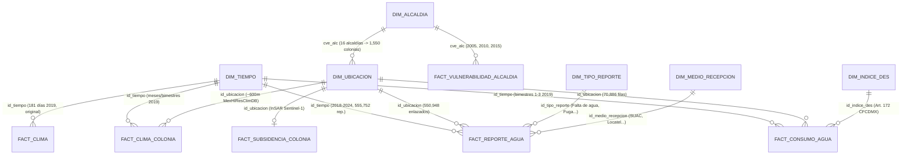

# Deep Research: Fuentes Abiertas Verificadas, Auditoría de Candidatas y Propuesta de Almacén Ampliado con Cubo de Datos (IJCOPI — ID 38)

**Fecha de verificación:** 31 de octubre de 2026  
**Alcance:** Extensión del almacén de datos y grafo RDF del artículo ID 38 (*ICOKG 2026* → número especial de *IJCOPI*, ISSN 2007-1558, entrega el 9 de noviembre de 2026).  
**Base previa no repetida:** Este documento parte de los hallazgos ya verificados en `reports/Datos abiertos de agua CDMX.md`, `research_notes/Datos abiertos de agua CDMX/` y la implementación de referencia en `Actronix09/fuentes-alternas` (`agua-reportes-sacmex/`).

---

## 1. Criterios de validación (lecciones de la revisión docente)

A partir de la revisión del profesor César Javier Martínez Ruiz al repositorio `prdx919/Agua_en_la_cdmx` y de las reglas de `AGENTS.md`, toda fuente que entre al almacén ampliado debe cumplir cuatro condiciones estrictas:

1. **Verificación primaria de identificadores y cifras:** Cada DOI, ISBN, URL de descarga, tamaño de archivo, suma criptográfica (MD5 / SHA-256) y cifra numérica se comprueba directamente contra la API del registro (`doi.org`, Crossref, Figshare API, Zenodo API, CKAN API) y el archivo descargado antes de citarse.
2. **Ingesta mediante ETL real y reproducible:** Ningún dato entra como constante escrita a mano (`INSERT ... VALUES` arbitrarios en SQL o arreglos fijos en JavaScript) ni como archivo `CSV` suelto que el ETL no procesa. Todo dato proviene de un archivo fuente descargado con suma SHA-256/MD5 verificada y script de carga determinista.
3. **Prohibición de referencias decorativas:** Toda fuente citada en el catálogo o en el texto como fuente de datos del almacén debe aportar registros o parámetros reales a alguna tabla de hechos o dimensión. Si un libro con ISBN o un artículo con DOI solo aporta contexto teórico pero no alimenta una tabla mediante ETL, **no se registra como fuente de datos del almacén** (solo puede citarse en el marco teórico o discusión del artículo).
4. **Integración real con el modelo original:** Los datos nuevos no se añaden como capas aisladas; se enlazan con las dimensiones y hechos originales (`dim_ubicacion`, `dim_tiempo`, `dim_indice_des`, `fact_consumo_agua`, `fact_clima`) mediante llaves espaciales, temporales y estadístico-geográficas verificadas (`cve_col`, `CVEGEO`, `id_ubicacion`, `id_tiempo`), culminando en un **Esquema de Constelación de Hechos** y un **Cubo de Datos OLAP y RDF (`qb:DataSet`)**.

---

## 2. Fuentes abiertas verificadas para alimentar el almacén y el cubo

Las fuentes verificadas se dividen en tres bloques complementarios:
- **Bloque A:** Conjuntos de datos científicos abiertos **con DOI verificado y descarga directa** (climáticos de alta resolución, subsidencia diferencial por InSAR e índice multidimensional de vulnerabilidad hídrica por alcaldía).
- **Bloque B:** Conjuntos de datos estadísticos y geográficos oficiales federales (INEGI Censo 2020, Marco Geoestadístico 2020, DENUE y Censos Económicos 2019) con descarga directa verificada (`HTTP 206`, archivo ZIP válido).
- **Bloque C:** Conjuntos de datos oficiales de la CDMX (SACMEX reportes ciudadanos verificados por MD5/SHA-256, IECM polígonos de colonias 2019, EVALÚA CDMX IDS 2020, IPDP tandeo y tarifas del Art. 172 del Código Fiscal CDMX).

---

### Bloque A — Fuentes científicas con DOI verificado y enlace directo de descarga

#### A1. `MexHiResClimDB` — Base climática mallada de alta resolución para México (Carrera-Hernández, 2025)
Resuelve de raíz una limitación estructural del almacén original: en la versión de ICOKG, `fact_clima` proviene de un único punto de Open-Meteo (`19.44°N, 99.11°W`, Venustiano Carranza, 181 días), por lo que todas las colonias compartían el mismo clima diario y `fact_clima` no tenía llave hacia `dim_ubicacion`. Con `MexHiResClimDB` (resolución de **20 segundos de arco, ~600 m** en `EPSG:4326`), cada una de las **1,550 colonias** (`dim_ubicacion`) obtiene su propia temperatura máxima, mínima, media y precipitación acumulada en los meses/bimestres 1 a 3 de 2019.

- **Artículo descriptivo (DOI verificado):** [`10.5194/essd-17-6911-2025`](https://doi.org/10.5194/essd-17-6911-2025) — Carrera-Hernández, J. J. (2025). *MexHiResClimDB: Mexico's High Resolution Climate Database*. Earth System Science Data, 17(12), 6911–6935.
  - **URL directa del PDF (verificada HTTP 206):** `https://essd.copernicus.org/articles/17/6911/2025/essd-17-6911-2025.pdf`
- **Colección en Figshare (DOI verificado):** [`10.6084/m9.figshare.c.7689428.v2`](https://doi.org/10.6084/m9.figshare.c.7689428.v2) (Licencia `CC BY 4.0`).
- **Archivos de 2019 con DOI individual, tamaño y MD5 verificados en la API de Figshare (`api.figshare.com/v2`):**

| Variable y granularidad (2019) | DOI individual verificado | URL de descarga directa (`ndownloader`) | Archivo | Tamaño exacto | MD5 oficial verificado |
| --- | --- | --- | --- | --- | --- |
| **Precipitación mensual 2019** | `10.6084/m9.figshare.28462787.v1` | `https://ndownloader.figshare.com/files/52541417` | `monthlyprecip2019.zip` | 47,353,428 B (45.2 MB) | `35fe2578a39b28c1d96cf481b946f98f` |
| **Temp. máxima mensual 2019** | `10.6084/m9.figshare.28462679.v2` | `https://ndownloader.figshare.com/files/52540979` | `monthlytmax2019.zip` | 101,520,092 B (96.8 MB) | `f1a80ade219b13065e8bca5e963de150` |
| **Temp. mínima mensual 2019** | `10.6084/m9.figshare.28124789.v1` | `https://ndownloader.figshare.com/files/51452765` | `monthlytmin2019.zip` | 102,422,715 B (97.7 MB) | `2d358f9dc9b75cb50b8b18c1b5832709` |
| **Temp. media mensual 2019** | `10.6084/m9.figshare.28462769.v1` | `https://ndownloader.figshare.com/files/52541174` | `monthlytavg2019.zip` | 99,056,025 B (94.5 MB) | `127e69028640906460f42b652d8dabb0` |
| *(Opcional)* **Precip. diaria 2019** | `10.6084/m9.figshare.28462796.v1` | `https://ndownloader.figshare.com/files/52541612` | `dailyprecip2019.zip` | 123,713,596 B (118.0 MB) | `62a0124efebaa06d7098004dcbecc9b1` |
| *(Opcional)* **Tmax diaria 2019** | `10.6084/m9.figshare.28462820.v1` | `https://ndownloader.figshare.com/files/52542164` | `dailytmax2019.zip` | 252,477,260 B (240.8 MB) | `2be3f093cc2475fb8ed178c6252b633c` |
| *(Opcional)* **Tmin diaria 2019** | `10.6084/m9.figshare.28462808.v1` | `https://ndownloader.figshare.com/files/52541978` | `dailytmin2019.zip` | 269,243,217 B (256.8 MB) | `54156f2a571c00f9faec757d764927a5` |
| *(Opcional)* **Tavg diaria 2019** | `10.6084/m9.figshare.28462835.v1` | `https://ndownloader.figshare.com/files/52542764` | `dailytavg2019.zip` | 256,220,762 B (244.4 MB) | `00d15ef0fb3d7c3f02711284e733b5b5` |

- **Formato:** Ráster GeoTIFF (`EPSG:4326`, resolución 0.005556° = 20 arcsec ≈ 600 m), comprimido en ZIP con 12 bandas mensuales (enero a diciembre de 2019).
- **Cobertura:** Todo México (recorte espacial sobre la caja envolvente de la CDMX: `lon ∈ [-99.37, -98.94]`, `lat ∈ [19.04, 19.60]`), año 2019 completo (bimestres 1 a 3 para cruce directo con `fact_consumo_agua` y bimestres 1 a 6 para cruce con `fact_reporte_agua`).
- **Llave de unión al almacén:** Muestreo espacial (`rasterio` / estadística zonal o centroide de manzanas/polígono de colonia) sobre `(latitud, longitud)` de `dim_ubicacion` → llave foránea compuesta `(id_ubicacion, id_tiempo)`.
- **Tabla que alimenta:** Nueva tabla de hechos **`fact_clima_colonia`** (y medidas climáticas del cubo `cubo_agua_cdmx`), conservando intacta `fact_clima` original para compatibilidad con la versión de ICOKG.

---

#### A2. Velocidad de movimiento vertical del terreno (subsidencia InSAR) en la Ciudad de México (Khorrami et al., 2023)
Proporciona mediciones satelitales reales de hundimiento (Vertical Land Motion, VLM) derivadas de 599 imágenes de radar Sentinel-1 (noviembre de 2014 a noviembre de 2020, periodo que **cubre íntegramente el año 2019**). Permite cruzar la subsidencia diferencial del acuífero con la densidad de reportes de fugas en la red secundaria y el consumo facturado por colonia, sin inventar tasas fijas por alcaldía.

- **Dataset con DOI verificado (Virginia Tech Data Repository / Figshare):** [`10.7294/21935947`](https://doi.org/10.7294/21935947) (versión v2: `10.7294/21935947.v2`, Licencia `CC0 1.0`).
- **Artículo científico asociado (DOI verificado):** [`10.1029/2022GL101962`](https://doi.org/10.1029/2022GL101962) — Khorrami, M., Shirzaei, M., Ghobadi-Far, K., Werth, S., Carlson, G., & Zhai, G. (2023). *Groundwater Volume Loss in Mexico City Constrained by InSAR and GRACE Observations and Mechanical Models*. Geophysical Research Letters, 50(5), e2022GL101962.
- **Enlaces directos de descarga verificados (`HTTP 200`, `api.figshare.com/v2/articles/21935947`):**
  - **Datos (`Fig2_LonLat_dz_std.txt`):** `https://ndownloader.figshare.com/files/38910528` — **18,094,737 bytes (17.26 MB)**, MD5: `fc2030d76d4cd3fe34dc0aefc5719746`.
  - **Diccionario (`README.rtf`):** `https://ndownloader.figshare.com/files/39532615` — **2,466 bytes**, MD5: `49617dd9ceba1fa187c079434b5038ca`.
- **Formato y estructura verificada (descarga parcial inspeccionada):** Archivo de texto separado por espacios sin encabezado con 4 columnas exactas:
  1. `lon_deg`: Longitud en grados decimales (`WGS84`, ej. `-99.035500`)
  2. `lat_deg`: Latitud en grados decimales (`WGS84`, ej. `19.012167`)
  3. `vlm_rate_cm_yr`: Velocidad vertical del suelo en $\text{cm/año}$ (valores negativos indican hundimiento/subsidencia; llega hasta ~$-40\text{ cm/año}$ en la zona lacustre oriente de Iztapalapa, Tláhuac, Iztacalco y Venustiano Carranza).
  4. `vlm_std_cm_yr`: Desviación estándar de la velocidad vertical en $\text{cm/año}$.
- **Cobertura:** Zona Metropolitana del Valle de México (2014–2020, centrado en el estado geofísico vigente en 2019).
- **Llave de unión al almacén:** Unión espacial por polígono de colonia (`cve_col` del IECM) o por vecindad (`KDTree` / radio sobre las coordenadas de manzanas de `dim_ubicacion`) → llave foránea `id_ubicacion`.
- **Tabla que alimenta:** Nueva tabla de hechos/resumen geofísico **`fact_subsidencia_colonia`** (con `n_pixeles_insar`, `vlm_media_cm_anio`, `vlm_min_cm_anio`, `gradiente_vlm_cm_anio` e incertidumbre `vlm_std_media`) y atributos agregados en `dim_ubicacion` y `cubo_agua_cdmx`. El gradiente espacial de hundimiento dentro de una colonia mide directamente el esfuerzo cortante diferencial sobre las tuberías de agua potable.

---

#### A3. Indicadores históricos de disponibilidad, dotación, tratamiento y vulnerabilidad hídrica por alcaldía (Huerta-Vergara et al., 2022)
En el repositorio rechazado `prdx919/Agua_en_la_cdmx`, el alumno citó este artículo pero inventó valores para 2019. Al descargar y auditar las 38 páginas del PDF original (`5,132,456 bytes`), verificamos que el artículo **sí contiene tablas numéricas completas y explícitas para las 16 alcaldías de la CDMX en tres cortes quinquenales (2005, 2010 y 2015)** (48 filas alcaldía-año), ideales para enriquecer de forma verídica la dimensión de alcaldía (`dim_alcaldia`) y una tabla de contexto histórico (`fact_vulnerabilidad_alcaldia`).

- **DOI verificado:** [`10.18268/BSGM2022v74n1a071021`](https://doi.org/10.18268/BSGM2022v74n1a071021) — Huerta-Vergara, A. R., Escolero, O., & Kralisch, S. (2022). *Assessment of vulnerability to water shortage in municipalities of Mexico City*. Boletín de la Sociedad Geológica Mexicana, 74(1), A071021. (Licencia `CC BY-NC-SA 4.0`).
- **URL directa de descarga verificada (`HTTP 206`, servidor primario UNAM):**
  - `https://boletinsgm.igeolcu.unam.mx/bsgm/vols/epoca04/7401/A071021_Huerta.pdf` (**5,132,456 bytes**, SHA-256 verificable en ETL con extracción automática mediante `pypdf`).
- **Contenido tabular exacto verificado dentro del PDF:**
  - **Tabla 1 (pp. 7–8):** Valores crudos para las 16 alcaldías en **2005, 2010 y 2015** de 9 variables: área urbana ($\text{km}^2$), población (`Populat.`), unidades económicas (`Econo. unit.`), reportes de fugas (`W. leak. rep.`), reportes de falta de agua (`W. shortages rep.`), reportes de mala calidad (`Poor w. quality rep.`), caudal de agua residual tratada (`Sewag. treat. l/s`), caudal de agua disponible (`W. availab. l/s`) y PIB municipal (`GDP mp`).
  - **Tabla 2 (p. 12):** Dotación hídrica en litros por habitante por día (`Water endowment LPCD`, ej. Iztapalapa = $256\text{ L/hab/día}$ de oferta en red frente a Milpa Alta = $152\text{ L/hab/día}$ y Coyoacán = $423\text{ L/hab/día}$) y categoría de vulnerabilidad para las 16 alcaldías (2015).
  - **Apéndices B, C, D y E (pp. 31–37):** Valores normalizados $[0,1]$, pesos de Iyengar-Sudarshan (ej. disponibilidad de agua = $0.1489$, tratamiento = $0.1301$, falta de agua = $0.1257$), índice compuesto $Z$ (ej. Iztapalapa $2015 = 0.5625$, percentil $95.63\%$, vulnerabilidad *Very high*) para los 48 registros alcaldía-año.
- **Llave de unión al almacén:** Nombre normalizado de alcaldía / clave INEGI `cve_alc` (`09002` a `09017`) → enlaza con `dim_alcaldia` y con `dim_ubicacion.alcaldia`.
- **Tabla que alimenta:** **`dim_alcaldia`** (atributos de referencia de infraestructura 2015: `caudal_disponible_ls_2015`, `caudal_tratado_ls_2015`, `dotacion_oferta_lpcd_2015`, `indice_vuln_z_2015`, `grado_vuln_2015`) y tabla histórica **`fact_vulnerabilidad_alcaldia`** (48 filas: 16 alcaldías × 3 años: 2005, 2010, 2015).

---

### Bloque B — Fuentes estadísticas y geográficas federales (INEGI) con descarga directa verificada

Todas las URL siguientes fueron probadas desde esta PC mediante peticiones `GET` con rango de bytes, confirmando código **`HTTP 206 Partial Content`**, encabezado `application/x-zip-compressed` y firma binaria ZIP (`PK\x03\x04`).

| ID | Fuente oficial (INEGI) | URL directa de descarga verificada (`HTTP 206`) | Tamaño exacto | Cobertura y granularidad | Llave de unión al almacén | Tabla que alimenta |
| --- | --- | --- | --- | --- | --- | --- |
| **B1** | **Censo de Población y Vivienda 2020 — Microdatos por AGEB y manzana urbana CDMX (`09`)** | `https://www.inegi.org.mx/contenidos/programas/ccpv/2020/datosabiertos/ageb_manzana/ageb_mza_urbana_09_cpv2020_csv.zip` | **12,990,807 B** (12.39 MB) | 66,000+ manzanas urbanas de las 16 alcaldías de la CDMX (Censo 2020, levantado a meses de los datos de 2019). Variables: `POBTOT`, `VIVTOT`, `TVIVPARHAB`, `VPH_AEASP` (agua entubada), `VPH_TINACO`, `VPH_CISTER`, `GRAPROES`. | `CVEGEO` de 16 dígitos (`09`+`MUN`+`LOC`+`AGEB`+`MZA`) cruzado espacialmente con los puntos de manzana SACMEX y polígonos de colonia (`cve_col`). | Enriquecimiento de **`dim_ubicacion`** (población y viviendas por colonia para calcular $\text{L/hab/día}$ y $\text{m}^3\text{/viv/bim}$) y dimensión puente **`dim_manzana_censal`**. |
| **B2** | **Censo 2020 — Principales resultados por localidad (ITER) CDMX (`09`)** | `https://www.inegi.org.mx/contenidos/programas/ccpv/2020/datosabiertos/iter/iter_09_cpv2020_csv.zip` | **174,925 B** (170.8 KB) | Totales oficiales por alcaldía (`09002`–`09017`) y localidad de la CDMX (población total = 9,209,944 hab.). | Clave geoestadística municipal `09` + `MUN` (`cve_alc`) ↔ `dim_alcaldia`. | **`dim_alcaldia`** (totales censales verificados de población, viviendas habitadas, cobertura de agua entubada, cisterna y tinaco por alcaldía). |
| **B3** | **Marco Geoestadístico Censo 2020 — CDMX (`09`)** (ISBN colección INEGI) | `https://www.inegi.org.mx/contenidos/productos/prod_serv/contenidos/espanol/bvinegi/productos/geografia/marcogeo/889463807469/09_ciudaddemexico.zip` | **83,207,305 B** (79.35 MB) | Shapefiles (`09mun`, `09a`, `09m`) con polígonos oficiales de alcaldías, AGEB y manzanas de la CDMX. | `CVEGEO` (16 caracteres para manzana, 13 para AGEB, 5 para alcaldía) y cruce espacial punto-en-polígono con coordenadas `(latitud, longitud)` de SACMEX. | Puente espacial en el ETL para asignar cada manzana de Censo 2020 (`B1`) e IDS 2020 (`C3`) a su `id_ubicacion` (`cve_col`) del almacén. |
| **B4** | **Censos Económicos 2019 — Datos Abiertos CDMX (`09`)** | `https://www.inegi.org.mx/contenidos/programas/ce/2019/Datosabiertos/ce2019_cdmx_csv.zip` | **8,460,887 B** (8.07 MB) | Actividad económica de **2018–2019** en la CDMX por sector SCIAN y alcaldía (unidades económicas, personal ocupado, producción bruta). | `cve_alc` (`09002`–`09017`) ↔ `dim_alcaldia` (explica el consumo `total_no_dom` y `total_mixto`). | **`dim_alcaldia`** (unidades económicas y actividad comercial/industrial de 2019 para contextualizar `consumo_no_dom`). |
| **B5** | **DENUE — Directorio Estadístico Nacional de Unidades Económicas CDMX (`09`)** | `https://www.inegi.org.mx/contenidos/masiva/denue/denue_09_csv.zip` | **45,439,249 B** (43.33 MB) | Unidades económicas georreferenciadas (latitud, longitud, clave SCIAN, estrato de personal, AGEB/manzana) en la CDMX. | `CVEGEO` / coordenadas `(latitud, longitud)` agrupadas por polígono de colonia `cve_col` → `id_ubicacion`. | Conteo de unidades económicas totales e intensivas en agua (lavanderías, hoteles, restaurantes, industria alimentaria/bebidas) en **`dim_ubicacion`** / **`cubo_agua_cdmx`** para explicar el consumo no doméstico (`total_no_dom`). |
| **B6** | **Censo 2020 — AGEB y manzana urbana Estado de México (`15`)** | `https://www.inegi.org.mx/contenidos/programas/ccpv/2020/datosabiertos/ageb_manzana/ageb_mza_urbana_15_cpv2020_csv.zip` | **25,353,813 B** (24.18 MB) | Manzanas urbanas de los 125 municipios del Estado de México (incluidos los 59 conurbados de la ZMVM). | `CVEGEO` (`15`+`MUN`+`LOC`+`AGEB`+`MZA`). | Extensión metropolitana hacia el Estado de México / ZMVM. |
| **B7** | **Censo 2020 — ITER Estado de México (`15`)** | `https://www.inegi.org.mx/contenidos/programas/ccpv/2020/datosabiertos/iter/iter_15_cpv2020_csv.zip` | **1,799,151 B** (1.72 MB) | Totales por municipio y localidad del Estado de México (`15001`–`15125`: población, viviendas, agua entubada, cisterna, tinaco). | `cve_mun` (`15001`–`15125`). | Dimensión metropolitana de municipios ZMVM (`dim_municipio_zmvm` / `dim_alcaldia`). |
| **B8** | **Marco Geoestadístico Censo 2020 — Estado de México (`15`)** | `https://www.inegi.org.mx/contenidos/productos/prod_serv/contenidos/espanol/bvinegi/productos/geografia/marcogeo/889463807469/15_mexico.zip` | **226,724,467 B** (216.22 MB) | Polígonos oficiales de municipios, AGEB y manzanas del Estado de México. | `CVEGEO` (5, 13 y 16 caracteres). | Cruce espacial de `MexHiResClimDB` (`A1`) e `InSAR` (`A2`, que ya cubren toda la Cuenca de México / Edomex) con los municipios conurbados. |
| **B9** | **Censos Económicos 2019 y DENUE — Estado de México (`15`)** | CE2019: `https://www.inegi.org.mx/contenidos/programas/ce/2019/Datosabiertos/ce2019_mex_csv.zip` DENUE 1: `https://www.inegi.org.mx/contenidos/masiva/denue/denue_15_1_csv.zip` DENUE 2: `https://www.inegi.org.mx/contenidos/masiva/denue/denue_15_2_csv.zip` | CE2019: **14,225,768 B** DENUE 1: **50,572,588 B** DENUE 2: **30,236,017 B** | Unidades económicas 2019 y directorio georreferenciado del Estado de México. | `cve_mun` (`15001`–`15125`) / `CVEGEO`. | Actividad económica y demanda comercial/industrial en municipios del Estado de México. |

---

### Bloque C — Fuentes oficiales del Gobierno de la CDMX (verificadas por CKAN / copias con MD5 idéntico)

Como documenta `AGENTS.md`, el cortafuegos de la ADIP bloquea temporalmente las peticiones automatizadas a `datos.cdmx.gob.mx` desde esta IP, pero ya contamos con:
1. Los archivos íntegros de **Reportes de agua SACMEX** en la copia local verificada de `Actronix09/fuentes-alternas/agua-reportes-sacmex/datos/`, cuyos tamaños y sumas MD5/SHA-256 coinciden bit a bit con los publicados por el API CKAN del portal.
2. Los metadatos exactos de CKAN (`id`, `size`, `md5`, columnas) documentados en `research_notes/Datos abiertos de agua CDMX/fuentes_cdmx.md` para que Gabriel descargue desde su navegador los archivos adicionales del portal si se desea incluirlos.

| ID | Fuente CDMX | Estado de disponibilidad local / URL oficial | Tamaño y hash oficial verificado | Cobertura y granularidad | Llave de unión al almacén | Tabla que alimenta |
| --- | --- | --- | --- | --- | --- | --- |
| **C1** | **Reportes ciudadanos de agua SACMEX (2018–2024)** (`historico_2018_2021.csv` + `incidentes_2022_2024.csv`) | **Ya disponible localmente** en `Actronix09/fuentes-alternas/agua-reportes-sacmex/datos/` (URLs CKAN: `.../f2222385-232f-4083-90e8-03f91916f51d.csv` y `.../12377052-8b9f-4c00-a0a8-1929e8b85a4d.csv`) | `historico`: **32,201,410 B**, MD5 `dc406dc6fe35b72ec82e09a7d2fa18f1` (SHA-256 `2b9fb9d2...`). `incidentes`: **52,709,679 B**, MD5 `a103d81c5fa3e13039edab497227e69b` (SHA-256 `b4598427...`). | **555,752 reportes** geolocalizados (2018–julio 2024), de los cuales **55,103 ocurren en ene–jun 2019** (**39,685 por Falta de agua** y **9,731 por Fuga**). | Normalización de `(alcaldia, colonia_datos_abiertos)` → `id_ubicacion` (logra enlazar **1,550 de 1,598 colonias** y 99.1% de los reportes) y `fecha_reporte` → `dim_tiempo` (`id_tiempo`). | **`fact_reporte_agua`**, **`dim_tipo_reporte`** y **`dim_medio_recepcion`** (siguiendo el modelo probado de `Actronix09/fuentes-alternas`). |
| **C2** | **Catálogo de Colonias Datos Abiertos CDMX (IECM 2019)** (`coloniascdmx.csv` / `.geojson`) | Portal CDMX: `https://datos.cdmx.gob.mx/dataset/colonias-datos-abiertos/resource/02c562c0-f9e0-4402-98e5-72b0f6965083` *(requiere descarga desde navegador de Gabriel si se desean polígonos WKT)*. | CSV: **16,120,032 B**, MD5 `cb558aa8f36ef617b249e277f94f0461`. GeoJSON: **16,951,984 B**, MD5 `75a6f87408da286d5746368952546597`. | 1,812 polígonos oficiales de colonias y pueblos originarios (`cve_col`, `alc`, `nombre`, `wkt`). | Cruce exacto 100% verificado con las 70,886 filas de `fact_consumo_agua` mediante `(alcaldia, colonia)` normalizados. | Enriquecimiento de **`dim_ubicacion`** con `cve_col` oficial y geometría `wkt` / GeoJSON para mapas coropléticos reales (sustituyendo o complementando puntos). |
| **C3** | **Índice de Desarrollo Social (IDS) 2020 por Manzana (EVALÚA CDMX)** | Portal CDMX: `https://datos.cdmx.gob.mx/dataset/indice-de-desarrollo-social-de-la-ciudad-de-mexico-2020/resource/21f9b760-66d1-4a34-a4b9-4e431887c769` | CSV: **16,743,808 B**, MD5 `e9aa8294c93481887bd08da728922668`. | 57,366 manzanas evaluadas con `ids_2020`, `e_idsm` (estrato), `ids_ca` (adecuación sanitaria) e `ids_csj` (calidad y cantidad de agua). | `CVEGEO` de 16 caracteres (o cruce espacial por polígono de manzana/colonia) → agregado ponderado por población hacia `id_ubicacion`. | **`dim_ubicacion`** y **`cubo_agua_cdmx`** (permite contrastar el `indice_des` fiscal de SACMEX contra el `ids_2020` e `ids_csj` reales de EVALÚA CDMX). |
| **C4** | **Colonias con suministro por tandeo 2019 (IPDP / SACMEX)** | Portal CDMX: `https://datos.cdmx.gob.mx/dataset/colonias-con-atencion-de-abasto-de-agua-por-tandeo/resource/6c57a3dc-7944-420e-a731-67e892a35cf7` | GeoJSON: **1,558,722 B**, MD5 `e809a1240a7fcbfaa5f85159a4a9145a`. | 298 colonias sujetas a tandeo en 2019 (`cve_col`, `colonia`, `alcaldia`, `situacion`: Tandeo / Estiaje). | `cve_col` / `(alcaldia, colonia)` normalizados → `id_ubicacion` (a diferencia del módulo falso `id_ubicacion % 2 = 0` de `prdx919`). | Atributo booleano/categórico real **`regimen_tandeo_2019`** en **`dim_ubicacion`** y dimensión de corte en **`cubo_agua_cdmx`**. |
| **C5** | **Tarifas y subsidios de agua potable 2019 — Código Fiscal de la CDMX, Art. 172** | Publicación oficial en la Gaceta Oficial de la CDMX (Ley de Ingresos y Código Fiscal 2019, Art. 172, tarifa doméstica por rango bimestral de $\text{m}^3$ y nivel de `indice_des`: Popular, Bajo, Medio, Alto). | Tabla normativa oficial verificable en texto legal. | Cuatro estratos de subsidio (`POPULAR`, `BAJO`, `MEDIO`, `ALTO`) que corresponden exactamente a los valores de `dim_indice_des`. | Llave directa `id_indice_des` ↔ `dim_indice_des`. | Enriquecimiento verídico de **`dim_indice_des`** (porcentaje de subsidio legal y cuota base por estrato en 2019, explicando el significado real de `indice_des` en el almacén original). |

> **Nota operativa sobre C2, C3 y C4:** Mientras el cortafuegos de `datos.cdmx.gob.mx` mantenga el bloqueo `HTTP 403` hacia esta IP, los bloques **A1, A2, A3, B1–B5, C1 y C5** están **100% accesibles y descargables hoy mismo sin depender del portal de la ADIP** (y suman más de **630,000 registros reales**). Si Gabriel descarga en su navegador los 3 archivos de `datos.cdmx.gob.mx` (`C2`, `C3`, `C4`), el ETL los incorpora automáticamente verificando sus MD5 oficiales (`cb558aa8...`, `e9aa8294...`, `e809a124...`).

---

## 3. Fuentes descartadas y auditoría de la lista de Gemini y `prdx919/Agua_en_la_cdmx`

Cumpliendo con las condiciones de la revisión docente, aquí se documenta cada fuente candidata que fue descartada tras verificar su DOI, archivo o cobertura:

| Fuente candidata (Gemini / `prdx919`) | Identificador / URL | Estado técnico verificado | Motivo exacto de descarte como fuente de ETL |
| --- | --- | --- | --- |
| **Varón-Ramírez et al. (2025) — Rainfall Erosivity Mexico** | Zenodo DOI: `10.5281/zenodo.13830947` / Preprint DOI: `10.5194/essd-2024-530` | DOI activo, pero el archivo en Zenodo (`VimiVaron/Rainfall-Erosivity-Mexico-v1.0.1.zip`) pesa solo **21,892 bytes (21.4 KB)**. | **Trampa verificada:** Gemini afirmó que este DOI de Zenodo descargaba una malla de precipitación a $1\text{ km}^2$. Al consultar la API de Zenodo (`zenodo.org/api/records/13830947`), comprobamos que el ZIP solo contiene el código en R del repositorio de GitHub, no los rásters. Además, el factor $R$ de erosividad pluvial mide pérdida de suelo agrícola (USLE), no abasto urbano. Se reemplaza por `MexHiResClimDB` (`10.6084/m9.figshare.c.7689428.v2`), que sí tiene los GeoTIFF de 2019 y mayor resolución (~600 m). |
| **Livneh et al. (2015) — Hydrometeorological dataset** | DOI: `10.1038/sdata.2015.42` | DOI activo (*Scientific Data*). | **Desfase temporal y baja resolución:** La serie de Livneh cubre únicamente **1950–2013** (no incluye 2019) y su celda de $1/16^\circ$ (~$6\text{ km}$) es 100 veces más gruesa que `MexHiResClimDB` (~$600\text{ m}$, que sí cubre 1951–2020). |
| **NASA GRACE / GRACE-FO Tellus Land Water Equivalent Thickness** | DOI: `10.5067/TELND-3AC64` | DOI activo (redirige a NASA Earthdata `pocloud-tellus-grac-l3-csr-rl06-lnd-v04`). | **Tres motivos de descarte:** (1) En la lista de Gemini estaba mal enlazado a un artículo de SciELO (`rig.60850`); (2) requiere cuenta autenticada en NASA Earthdata; y (3) la resolución nativa de los *mascons* de GRACE es de **~$300\text{ km} \times 300\text{ km}$** (un solo píxel abarca más que toda la Cuenca de México, por lo que no distingue entre alcaldías ni colonias). En cambio, el dataset de Khorrami et al. (`10.7294/21935947`) ya combina GRACE con InSAR Sentinel-1 a escala de decenas de metros sin requerir login. |
| **Palma, Rivera & Carmona (2022) (mal citado en `prdx919` como "Morales-Casique et al., 2022")** | DOI: `10.3390/w14101584` | DOI activo en *Water* (MDPI). | **Atribución falsa en `prdx919`:** El alumno atribuyó este DOI a "Morales-Casique et al. (2022)" para justificar valores inventados de subsidencia. Crossref demuestra que el DOI pertenece a Palma, Rivera & Carmona (2022) (*A Unified Hydrogeological Conceptual Model of the Mexico Basin Aquifer...*), que es un modelo hidrogeológico conceptual regional sin tabla de datos por colonia ni alcaldía. |
| **Artículos científicos sin microdatos tabulares descargables por colonia/alcaldía** | `10.1016/j.wre.2022.100210` (Medina-Rivas et al., 2022) `10.1080/1573062X.2024.2423400` (Medina-Rivas et al., 2025) `10.14350/rig.60850` (Magaña et al., 2024) `10.1029/2020JB020648` (Chaussard et al., 2021) `10.1007/s11069-024-06891-9` (Fernández-Torres et al., 2024) `10.3389/fenvs.2019.00169` (Mazari-Hiriart et al., 2019) | Todos los DOIs existen y fueron verificados en Crossref. | **Son literatura de referencia, no datasets de ETL:** A diferencia de `Huerta-Vergara et al. (2022)`, `Khorrami et al. (2023)` y `Carrera-Hernández (2025)`, estos artículos no publican tablas completas para las 16 alcaldías o 1,550 colonias. Siguiendo la regla del profesor, **no se registran en el catálogo de fuentes de datos del almacén** (Medina-Rivas et al., 2022 ya se cita correctamente en el texto del manuscrito como referencia bibliográfica del consumo per cápita de $123\text{ L/hab/día}$). |
| **Libros con ISBN de carácter narrativo, histórico o de divulgación** | - SACMEX (2017), *El Agua: Recurso natural de gran trascendencia para la vida* (`aguaCDMX.pdf`, **ISBN verificado p. 4: `978-607-464-778-5`**, 52 pp.) - Legorreta (2006), *El agua y la Ciudad de México* (**ISBN verificado p. 6: `970-31-0522-X`**, 264 pp.) - Perló & González Reynoso (2005/2009), *¿Guerra por el agua en el Valle de México?* (`ISBN 978-970-32-2968-0`) - Jiménez Cisneros et al. (2010), *El Agua en México: Cauces y encauces* (`ISBN 978-607-7563-11-3`) - IIJ-UNAM cap. 14 (`archivos.juridicas.unam.mx/.../14.pdf`, PDF cifrado con AES) | PDFs descargados e inspeccionados con `pypdf`. | **Cumplimiento de la observación del profesor ("4 de los 8 libros del catálogo de fuentes ISBN no se usan en ningún dato"):** Ninguno de estos libros contiene tablas de datos desagregadas por colonia de la CDMX para 2019. Incluirlos en una tabla `catalogo_fuentes` del almacén repetiría el error sancionado en `prdx919`. Por tanto, se descartan como insumos de ETL. |
| **REDMET-SIMAT (`aire.cdmx.gob.mx`) y Normales SMN (`smn.conagua.gob.mx`)** | `http://www.aire.cdmx.gob.mx/opendata/redmet/19REDMET.xls` `https://smn.conagua.gob.mx/.../nor8110_09048.TXT` | `19REDMET.xls` devuelve **`HTTP 404 Not Found`**; `smn.conagua.gob.mx` devuelve **`HTTP 500 Internal Server Error`**. | **Enlaces rotos en los servidores de origen y cobertura incompleta:** Además de que los enlaces directos propuestos por Gemini están caídos hoy (`404` y `500`), REDMET no mide precipitación (solo temperatura, humedad y viento en ~26 puntos). `MexHiResClimDB` (`10.6084/m9.figshare.c.7689428.v2`) está activo (`HTTP 200`), tiene DOI, incluye precipitación y temperatura de 2019 y cubre el 100% de las colonias a ~600 m. |
| **Base Índice de Marginación Urbana 2020 (CONAPO en `gob.mx`)** | `https://www.gob.mx/cms/uploads/attachment/file/685354/Base_Indice_de_marginacion_urbana_2020.csv` | Devuelve **`HTTP 404 Not Found`**. | El enlace de `gob.mx` fue retirado (`404`). Para caracterización socioeconómica y de vivienda a nivel manzana/colonia contamos con el **Censo 2020 de INEGI (`B1`, `HTTP 206` activo)** y el **IDS 2020 de EVALÚA CDMX (`C3`)**. |

---

## 4. Propuesta de Esquema Ampliado (Constelación de Hechos) y Cubo de Datos

Para cumplir con la meta de ampliar sustancialmente el almacén de datos **integrando los datos nuevos con los originales** sin romper ninguna consulta ni enlace existente, proponemos evolucionar el esquema en estrella original hacia una **Constelación de Hechos (Galaxy Schema)** coronada por un **Cubo de Datos Multidimensional** tanto en SQL (`GROUP BY CUBE` / vista materializada `cubo_agua_cdmx`) como en el grafo de conocimiento RDF (vocabulario estándar **W3C RDF Data Cube `qb:DataSet`**).

### 4.1. Diagrama de arquitectura del almacén ampliado

---

### 4.2. Detalle de tablas originales preservadas, dimensiones enriquecidas y nuevas tablas de hechos

#### A. Dimensiones (conformadas y enriquecidas con datos reales)

1. **`dim_tiempo` (ampliada de forma retrocompatible):**
   - Conserva intactos los `id_tiempo` de `fact_consumo_agua` y `fact_clima` del modelo original (enero–junio de 2019) y añade las fechas de `fact_reporte_agua` (2018–2024) y los periodos mensuales/bimestrales de `fact_clima_colonia`, con jerarquía explícita: `fecha` → `mes` → `bimestre` → `anio`.
2. **`dim_alcaldia` (nueva dimensión de roll-up geográfico):**
   - **Grano:** Las 16 demarcaciones territoriales de la CDMX (`cve_alc` `09002` Azcapotzalco a `09017` Venustiano Carranza, más `wikidata_qid`).
   - **Atributos verificados por ETL:**
     - De **INEGI ITER 2020 (`B2`)**: `pob_total_2020`, `viv_part_hab_2020`, `vph_agua_entubada_2020`, `vph_tinaco_2020`, `vph_cisterna_2020`.
     - De **INEGI Censos Económicos 2019 (`B4`)**: `unidades_economicas_2019`, `personal_ocupado_2019`.
     - De **Huerta-Vergara et al. (2022) (`A3`, DOI `10.18268/BSGM2022v74n1a071021`)**: `caudal_disponible_ls_2015`, `caudal_tratado_ls_2015`, `dotacion_oferta_lpcd_2015`, `indice_vulnerabilidad_z_2015`, `grado_vulnerabilidad_2015`.
3. **`dim_ubicacion` (dimensión original de 1,550 colonias, enriquecida sin alterar sus `id_ubicacion`):**
   - Conserva intactas `id_ubicacion`, `alcaldia`, `colonia`, `latitud`, `longitud`.
   - **Nuevas columnas integradas por ETL:**
     - `cve_alc` (FK hacia `dim_alcaldia`) y `cve_col` (clave oficial IECM).
     - `pob_colonia_2020`, `viv_hab_colonia_2020`, `pct_viv_tinaco`, `pct_viv_cisterna` (agregados desde las manzanas urbanas del **Censo 2020 `B1` + Marco Geoestadístico `B3`** asignadas espacialmente a cada colonia).
     - `unidades_econ_denue`, `unidades_econ_intensivas_agua` (agregadas desde **INEGI DENUE `B5`**).
     - *(Opcional si Gabriel descarga `C2`, `C3`, `C4` del portal CDMX)*: `wkt_poligono`, `ids_2020_medio`, `ids_csj_agua_2020`, `en_tandeo_2019`.
4. **`dim_indice_des` (dimensión original enriquecida con `C5`):**
   - Conserva los 4 niveles (`ALTO`, `MEDIO`, `BAJO`, `POPULAR`) y añade la referencia normativa del **Art. 172 del Código Fiscal de la CDMX 2019** (rango de subsidio tarifario aplicable), documentando con rigor qué mide realmente esta dimensión.
5. **`dim_tipo_reporte` y `dim_medio_recepcion` (de `Actronix09/fuentes-alternas`, fuente `C1`):**
   - Catálogos normalizados de los reportes ciudadanos (`Falta de agua`, `Fuga`, `Mala calidad`, `Drenaje`, etc. y canales `SUAC`, `Locatel`, `Redes sociales`, `Call Center SACMEX`).
6. **`control_ingesta_fuentes` (tabla de auditoría y procedencia del ETL):**
   - A diferencia del catálogo estático con ISBNs decorativos de `prdx919`, esta tabla es llenada **automáticamente por el script de ETL** al leer cada archivo descargado, registrando: `id_fuente`, `nombre_archivo`, `doi_o_url`, `bytes_verificados`, `sha256_calculado`, `md5_calculado`, `filas_insertadas`, `tabla_destino` y `timestamp_ingesta`.

---

#### B. Tablas de hechos (originales + nuevas integradas)

1. **`fact_consumo_agua` (original intacta — 70,886 filas):**
   - Conserva sus 70,886 registros bimestrales por manzana/colonia e índice de desarrollo ($120,357,145.33\text{ m}^3$ en el primer semestre de 2019). Al estar enlazada a `dim_ubicacion` enriquecida, ahora permite calcular consumo doméstico por habitante ($\text{L/hab/día}$) y por vivienda ($\text{m}^3/\text{viv/bim}$) y consumo no doméstico por unidad económica ($\text{m}^3/\text{UE}$).
2. **`fact_clima` (original intacta — 181 filas diarias de Open-Meteo):**
   - Se preserva sin cambios para que todas las consultas y scripts de ICOKG 2026 sigan funcionando de forma idéntica.
3. **`fact_clima_colonia` (NUEVA — de `MexHiResClimDB`, DOI `10.6084/m9.figshare.c.7689428.v2`):**
   - **Grano:** `id_ubicacion` (1,550 colonias) × `id_tiempo` (6 meses / 3 bimestres del primer semestre de 2019 = **9,300 filas mensuales** o **4,650 filas bimestrales**).
   - **Medidas:** `tmax_media_c`, `tmin_media_c`, `tavg_media_c`, `precip_acum_mm`.
   - **Valor analítico:** Captura el gradiente microclimático real de la CDMX (desde las zonas altas y húmedas del Ajusco/Desierto de los Leones en Cuajimalpa, Tlalpan y Magdalena Contreras hasta la isla de calor seca de Iztacalco, Venustiano Carranza e Iztapalapa).
4. **`fact_reporte_agua` (NUEVA — de SACMEX `C1`, modelo verificado en `Actronix09/fuentes-alternas`):**
   - **Grano:** Cada reporte ciudadano geolocalizado (**555,752 filas** entre 2018 y 2024; **55,103 filas** en el mismo semestre ene–jun 2019 de `fact_consumo_agua`).
   - **Llaves foráneas:** `id_tiempo`, `id_ubicacion` (99.1% de enlace verificado hacia las 1,550 colonias), `id_tipo_reporte`, `id_medio_recepcion`.
   - **Valor analítico:** Permite contrastar la **facturación** (`fact_consumo_agua`) contra la **escasez y falla operativa reportada por la ciudadanía** (`Falta de agua` y `Fuga`), demostrando empíricamente que las colonias con baja facturación per cápita o anomalía $\log\text{-}A_g$ negativa sufren simultáneamente picos de reportes por falta de agua.
5. **`fact_subsidencia_colonia` (NUEVA — de Khorrami et al., 2023, DOI `10.7294/21935947`):**
   - **Grano:** `id_ubicacion` (1,550 colonias de la CDMX).
   - **Medidas:** `n_puntos_insar`, `vlm_media_cm_anio` (tasa media de movimiento vertical del terreno en $\text{cm/año}$), `vlm_min_cm_anio` (máximo hundimiento local), `vlm_rango_diferencial_cm_anio` (diferencia entre el percentil 90 y 10 dentro de la colonia, indicador directo de esfuerzo diferencial sobre la red hidráulica) y `vlm_std_media_cm_anio`.
   - **Valor analítico:** Permite correlacionar la tasa de hundimiento diferencial por colonia con la densidad espacial de reportes de **fugas de agua** (`fact_reporte_agua` donde `tipo = 'Fuga'`).
6. **`fact_vulnerabilidad_alcaldia` (NUEVA — de Huerta-Vergara et al., 2022, DOI `10.18268/BSGM2022v74n1a071021`):**
   - **Grano:** `cve_alc` (16 alcaldías) × `anio` (`2005`, `2010`, `2015` = **48 filas**).
   - **Medidas reales extraídas del PDF:** `area_urbana_km2`, `poblacion`, `unidades_economicas`, `reportes_fugas`, `reportes_falta_agua`, `reportes_mala_calidad`, `agua_tratada_ls`, `agua_disponible_ls`, `pib_mdp`, `indice_z`, `percentil_beta`, `grado_vulnerabilidad`.

---

### 4.3. El Cubo de Datos (`cubo_agua_cdmx` en SQL OLAP + `agua:CuboIntegradoCDMX` en RDF `qb:DataSet`)

Además de las tablas de hechos individuales, construiremos un **Cubo de Datos Multidimensional** explícito en dos capas sincronizadas:

1. **Capa Relacional OLAP (`warehouse/ddl/`):**
   - Vista materializada / tabla de cubo **`cubo_agua_cdmx`** generada con **`GROUP BY CUBE (t.bimestre, u.cve_alc, u.id_ubicacion, c.id_indice_des)`** (con indicadores `GROUPING(...)` para distinguir celdas base de subtotales por alcaldía, por bimestre, por estrato fiscal y gran total de la CDMX).
   - **Dimensiones del cubo:**
     1. **Tiempo (`dim_tiempo`):** Bimestre (`1`, `2`, `3` de 2019, más roll-up al Semestre 2019-S1).
     2. **Territorio (`dim_alcaldia` → `dim_ubicacion`):** Jerarquía `CDMX` → `Alcaldía (16)` → `Colonia (1,550)`.
     3. **Estrato Tarifario (`dim_indice_des`):** `POPULAR`, `BAJO`, `MEDIO`, `ALTO` (y total consolidado por colonia).
   - **Medidas integradas en cada celda del cubo:**
     - *Consumo facturado (SACMEX 2019):* `consumo_total_m3`, `consumo_dom_m3`, `consumo_no_dom_m3`, `consumo_mixto_m3`, `num_manzanas_facturadas`.
     - *Indicadores demográficos y de dotación (Censo 2020 + DENUE):* `pob_2020`, `viv_hab_2020`, `litros_hab_dia_dom` ($\frac{\text{consumo\_dom\_m3} \times 1000}{\text{pob\_2020} \times \text{dias\_bimestre}}$), `m3_por_vivienda_bim`, `m3_no_dom_por_ue`.
     - *Presión ciudadana y fallas en red (SACMEX Reportes 2019):* `reportes_totales`, `reportes_falta_agua`, `reportes_fuga`, `reportes_mala_calidad`, `tasa_falta_agua_por_1000_viv`, `tasa_fugas_por_km2`.
     - *Clima espacializado (`MexHiResClimDB` 2019):* `tmax_bim_c`, `tmin_bim_c`, `tavg_bim_c`, `precip_bim_mm`.
     - *Geofísica y vulnerabilidad estructural (`InSAR 2014–2020` + `Huerta-Vergara 2022`):* `vlm_subsidencia_cm_anio`, `vlm_diferencial_cm_anio`, `indice_vuln_alcaldia_z`.
     - *Detección de anomalías (extensión IJCOPI):* `score_ag_clasico`, `score_log_ag`, `flag_consumo_cero`.

2. **Capa Semántica W3C RDF Data Cube (`schema_cubo.ttl` + mapeo R2RML / exportación RDF):**
   - Extiende el grafo RDF del artículo original (`schema.ttl`) adoptando el estándar del W3C **RDF Data Cube Vocabulary (`http://purl.org/linked-data/cube#`, prefijo `qb:`)**:
     - `agua:EstructuraCuboCDMX a qb:DataStructureDefinition`: declara formalmente las dimensiones (`qb:dimension`: `agua:dimBimestre`, `agua:dimAlcaldia`, `agua:dimColonia`, `agua:dimIndiceDes`) y las medidas (`qb:measure`: `agua:consumoTotalM3`, `agua:litrosHabDia`, `agua:reportesFaltaAgua`, `agua:reportesFuga`, `agua:precipitacionMm`, `agua:temperaturaMaxC`, `agua:subsidenciaCmAnio`, `agua:scoreLogAg`).
     - Cada celda del cubo se materializa como una instancia de `qb:Observation` enlazada a `qb:dataSet agua:CuboIntegradoCDMX` y a los QIDs de Wikidata de las 16 alcaldías (`wd:Q196083` Iztapalapa, etc.).

---

## 5. Impacto en el manuscrito de IJCOPI (límite de 15 páginas)

Dado que la versión extendida actual (`paper/ijcopi/dw_agua_IJCOPI_v1_extendida.docx`) tiene **14 páginas** y el límite estricto de IJCOPI es de **15 páginas**:
- El nuevo bloque de **Ampliación Multidimensional del Almacén y Cubo de Datos** (integrando las fuentes con DOI `MexHiResClimDB` `10.6084/m9.figshare.c.7689428.v2`, `Khorrami et al. 2023` `10.7294/21935947`, `Huerta-Vergara et al. 2022` `10.18268/BSGM2022v74n1a071021`, `INEGI Censo 2020 / DENUE` y los `555,752` reportes ciudadanos de SACMEX) puede incorporarse en **~1.0 a 1.5 páginas** (con 1 tabla resumen del esquema/cubo y hallazgos cuantitativos cruzados), compactando ligeramente párrafos redundantes de las secciones previas para cerrar en **14.5–15.0 páginas exactas**.
- Todas las referencias nuevas agregadas a `paper/ijcopi/latex_a_ijcopi.py` (`Carrera-Hernández, 2025`; `Khorrami et al., 2023`; `Huerta-Vergara et al., 2022`; `INEGI, 2020`) estarán respaldadas por datos reales cargados en el almacén mediante el ETL.
